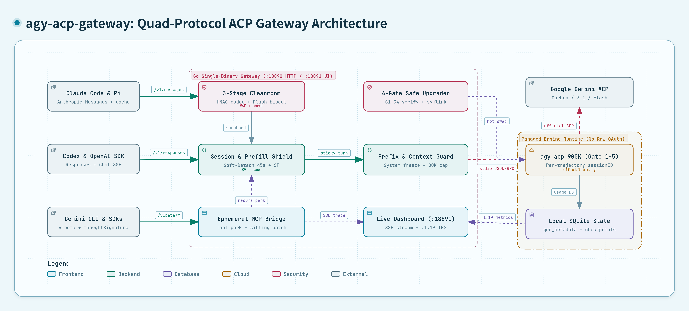
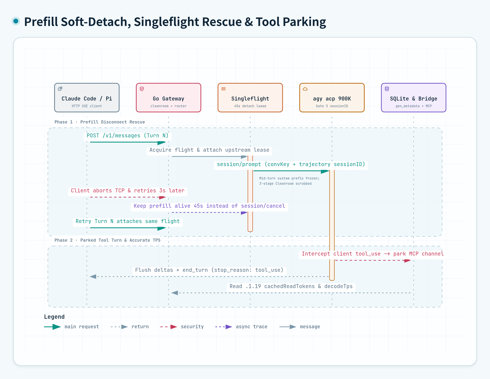

<p align="center">
  <picture>
    <source media="(prefers-color-scheme: dark)" srcset="assets/banner-dark.svg" />
    
  </picture>
</p>

<h3 align="center">Single-binary Go gateway that turns official <code>agy acp</code> into Anthropic <code>/v1/messages</code>, OpenAI <code>/v1/chat/completions</code>, <code>/v1/responses</code>, <code>/v1/images/*</code>, and Google Gemini <code>/v1beta</code> APIs, with a multi-account pool and <code>:18891</code> Web console.</h3>

<p align="center">
  <a href="./README.md"><strong>English</strong></a> &nbsp;·&nbsp;
  <a href="./README_ZH.md"><strong>简体中文</strong></a> &nbsp;·&nbsp;
  <a href="#quick-start"><strong>Quick Start</strong></a> &nbsp;·&nbsp;
  <a href="#client-setup"><strong>Client Setup</strong></a> &nbsp;·&nbsp;
  <a href="#models"><strong>Models &amp; Multimodal</strong></a> &nbsp;·&nbsp;
  <a href="#image-generation"><strong>Image Gen</strong></a> &nbsp;·&nbsp;
  <a href="#multi-account"><strong>Pool &amp; Memory</strong></a> &nbsp;·&nbsp;
  <a href="#architecture"><strong>Architecture</strong></a> &nbsp;·&nbsp;
  <a href="#configuration-reference"><strong>Config &amp; Metrics</strong></a> &nbsp;·&nbsp;
  <a href="#safe-upgrader"><strong>Upgrader</strong></a> &nbsp;·&nbsp;
  <a href="#troubleshooting"><strong>Troubleshooting</strong></a>
</p>

<p align="center">
  
  
  
  
  
  <a href="LICENSE"></a>
</p>

---

**`agy-acp-gateway`** wraps Google's official Antigravity CLI (`agy acp`, JSON-RPC 2.0 over stdio) into a single zero-CGO Go binary exposing standard Anthropic, OpenAI, and Gemini HTTP APIs (`:18890`) alongside a real-time multi-account Web console (`:18891`).

Unlike unofficial proxies that forge private OAuth or Protobuf HTTP requests, **every upstream request runs inside the official `agy` binary**. Google's binary handles TLS handshakes, OAuth token refreshes, trajectory checkpoints, and upstream framing. `agy-acp-gateway` adds:

- **Standard Multi-Protocol APIs (`:18890`)**: Anthropic `/v1/messages`, OpenAI `/v1/chat/completions` and `/v1/responses`, native Google Gemini `/v1beta`, plus image generation and editing via 3 entry points (`/v1/images/generations` & `/v1/images/edits`, `/v1/chat/completions`, and `/v1beta/models/gemini-3.1-flash-image:generateContent`).
- **12 Models + Full Multimodal**: 11 chat models (Gemini 4 family, `gemini-3.8-flash`, Claude Opus/Sonnet 5.5, `gpt-oss-120b-medium`, 3 `gemini-pro-orchestrator` models) plus `gemini-3.1-flash-image`. Handles magic-checked images (`PNG`, `JPEG`, `WEBP`, `GIF`, `HEIC`, `HEIF`), 24 UTF-8 text formats (`<=2 MiB`), built-in pure-Go text PDF extraction on all models, and opt-in isolated Media Relay (`AGY_MEDIA_RELAY=1`, `20 MiB` default per file) for Gemini scanned PDF, audio, and video.
- **Multi-Account Pool & Anti-Ban Isolation**: Runs isolated per-account sandboxes inside one container (separate OAuth tokens, egress proxies, model allowlists, and per-account or per-group keys). Keeps multi-turn conversations pinned to their original account to prevent cross-account history replay and preserve 95%+ prompt cache hit rates. Tracks 5-hour pre-tool safety check limits per account with live presets (`80%` / `88%` / `93%` / custom) and a `Shared Account` flag for multi-device accounts.
- **6 GB Small-Memory High Concurrency (`v2.3.26`)**: Runs 20-30 concurrent coding subagents on a 6 GB server using dual-layer worker caps (`AGY_GLOBAL_IDLE_TARGET=8`, `AGY_GLOBAL_BURST_MAX_LIVE_WORKERS=18`), lossless warm hibernation for idle tool waits (`Elastic Parked Offload`), a single-process `ws-imagegen` engine (`243 MB` single / `261 MB` at 2 concurrent), slim `80 MiB` child gateways, and glibc allocator limits.

<p align="center">
  <picture>
    <source media="(prefers-color-scheme: dark)" srcset="assets/arch-overview-dark.png" />
    
  </picture>
</p>

---

## Why `agy-acp-gateway`?

| Problem | Spoofed Proxy / Thin Wrapper | `agy-acp-gateway` |
| :--- | :--- | :--- |
| **Account ban & fingerprint risk** | Forges private OAuth/Protobuf requests or replays mid-turn history across accounts | Runs 100% through official `agy acp`; pins active multi-turn threads to one account; isolates each account's directory and exit IP |
| **Rate limits & standby overflow** | One global `~/.gemini` home; manual restart on `429`/`529` | Multi-account pool with 5 strategies, `primary`/`standby` roles, Turn-1 failover, per-family cooldowns, `VALIDATION_REQUIRED` verify + recheck, and 1-click drain-and-rotate |
| **5h tool safety check lockouts** | Exhausts free `sir_flash_lite` checks silently, triggering `~80x` escalated checks | Tracks 5h tool safety check counts per account, balances new tool threads, pauses new tool assignments before lockout, and sends zero-tool turns to busier accounts |
| **0% prompt cache under concurrency** | Shares empty trajectory IDs or changes `system`/tool prefixes mid-session | Per-session `SessionId` isolation, frozen Turn-1 system/tool prefix, and in-place tool updates (`TOOLS_UPDATED_IN_PLACE`) |
| **Slow prefill disconnect storms** | Cancels 150K+ upstream prefill on client timeout | Holds prefills running `>=30s` alive for `45s` on disconnect so retries re-attach to the same upstream stream |
| **Client prompt tags hit 400 WAF** | Fails requests or strips user text with lossy regexes | Reversibly encodes internal tags and paths with session `HMAC-SHA256`, and bisects unknown 400 blocks with `gemini-3.8-flash` |
| **High RAM usage with 20+ subagents** | Spawns unbounded workers and OOMs on 4-8 GB hosts | Separates idle retention (`AGY_GLOBAL_IDLE_TARGET=8`) from burst concurrency (`AGY_GLOBAL_BURST_MAX_LIVE_WORKERS=18`), offloads long tool waits without dropping cache, and runs single-process image generation |

---

<a id="quick-start"></a>

## 3-Minute Quick Start

### Prerequisites

- **OS**: Linux (`x86_64` / `linux_arm64`), macOS (`darwin_arm64`), or Windows with WSL2 Ubuntu.
- **Official Antigravity CLI (`agy`)**: Installed at `~/.local/bin/agy`. Recommended baseline is **`1.5.16`** (upstream `1.5.17` and `1.5.18` have a `4x` `--agent` Gemini quota burn bug; the gateway never modifies `~/.local/bin/agy`).
- **Build tools** *(when building from source)*: Go `1.26+` and Python `3.10+`.

### Option A: Docker Compose (Recommended for Servers & Multi-Account Pools)

```bash
# 1. Clone the repository
git clone https://github.com/yuhxuiao/agy-acp-gateway.git
cd agy-acp-gateway

# 2. Build the zero-CGO gateway binary and create the --acp-only 900K patched agy binary
cd go-gateway && CGO_ENABLED=0 go build -trimpath -ldflags="-s -w" -o ../bin/agy-acp-gateway . && cd ..
./scripts/agy-upgrade.sh --official ~/.local/bin/agy --contract
./scripts/agy-upgrade.sh --install --candidate <candidate_dir_printed_above>

# 3. Copy the env template, set AGY_API_KEYS, and start the container
cp .env.example deploy/.env
# Edit deploy/.env and replace AGY_API_KEYS with your own key.
# Leave AGY_UPSTREAM_PROXY commented out unless your container can reach that proxy.
docker compose -f deploy/docker-compose.yml up -d --build

# 4. Check health
curl -fsS http://127.0.0.1:18890/healthz
# Expected output: {"ok":true}
```

### Option B: Native Binary (`./scripts/gw.sh`)

```bash
# 1. Run tests and build the binary
cd go-gateway
gofmt -l . && go vet ./... && go test -race -count=1 ./...
CGO_ENABLED=0 go build -trimpath -ldflags="-s -w" -o ../bin/agy-acp-gateway .
cd ..

# 2. Create and verify ./bin/agy-acp-900k (leaves ~/.local/bin/agy untouched)
./scripts/agy-upgrade.sh --official ~/.local/bin/agy --contract
./scripts/agy-upgrade.sh --install --candidate <candidate_dir_printed_above>

# 3. Configure .env and start
cp .env.example .env
# Edit .env: set AGY_API_KEYS and AGY_UPSTREAM_PROXY (set AGY_UPSTREAM_PROXY= for direct access)
./scripts/gw.sh start
./scripts/gw.sh status
```

### Step 3: Authorize Google Accounts (3 Methods)

Open `http://127.0.0.1:18891/` in your browser. For HTTP Basic Auth, enter any username and your `AGY_API_KEYS` master key as the password, then click **账号** in the top bar:

1. **WebUI PKCE OAuth (Linux / WSL2 / Docker; best for servers and secondary accounts)**:
   - *(On native `darwin_arm64`, `/dev/ptmx` PTY login is unavailable; use Method 2 token import or Method 3 CLI login instead.)*
   - Click **新增账号槽位** (or **网页授权** on an existing account), pick an exit proxy (`direct`, a named preset, or a custom `http://` / `https://` / `socks5://` / `socks5h://` URL), and save.
   - Click **第 1 步：生成 Google 授权链接**. Open the `https://accounts.google.com/...` URL in any local browser, sign in, and copy the resulting `http://localhost:.../?code=...` URL (a "connection refused" page on localhost is expected) into **第 2 步**, then click **提交授权码激活**.
2. **Offline Token JSON Import**:
   - In the same OAuth panel, paste an existing `antigravity-oauth-token` JSON object (`{"access_token":...,"refresh_token":...}`) and click **直接写入 Token JSON**.
3. **Interactive CLI *(Primary Account Only)***:
   - Native host: `./bin/agy-acp-900k login`
   - Docker: `docker exec -it agy-acp-gateway /app/bin/agy-acp-900k login`

### Step 4: Verify Your First Chat Request

```bash
curl -sS http://127.0.0.1:18890/v1/chat/completions \
  -H "Authorization: Bearer sk-your-master-key" \
  -H "Content-Type: application/json" \
  -d '{
    "model": "gemini-3.8-flash",
    "reasoning_effort": "low",
    "messages": [{"role": "user", "content": "Reply with READY in one word."}]
  }'
```

---

<a id="client-setup"></a>

## Client Setup (Copy-Paste Ready)

| Client / SDK | Endpoint | Base URL | Auth Header / Env | Continuity & Tool Bridge |
| :--- | :--- | :--- | :--- | :--- |
| **`Claude Code`** | Anthropic `/v1/messages` | `http://127.0.0.1:18890` | `x-api-key` / `ANTHROPIC_API_KEY` | `metadata.user_id` + `ws-bridge` MCP + client `WebFetch` |
| **`Codex` CLI** | OpenAI `/v1/responses` | `http://127.0.0.1:18890/v1` | `Authorization: Bearer` | `prompt_cache_key` / Turn-1 hash + stateless history + MCP |
| **Cursor / Continue / `Cline` / `Roo Code` / `OpenCode`** | OpenAI `/v1/chat/completions` | `http://127.0.0.1:18890/v1` | `Authorization: Bearer` | Turn-1 `(system + first_user)` hash + parallel tool batching |
| **Gemini CLI / `google-genai` SDK** | Gemini `/v1beta` | `http://127.0.0.1:18890` | `x-goog-api-key` / `?key=` | Native `functionCall` / `thoughtSignature` + MCP |
| **Pi Coding Agent** | `/v1/messages` or `/v1/responses` | `http://127.0.0.1:18890` | `x-api-key` / `Bearer` | `x-pi-session-id` + in-place tool updates |
| **Image Clients (3 Protocols)** | `/v1/images/*`, `/v1/chat/completions`, `/v1beta` | `http://127.0.0.1:18890` | `Bearer` / `x-api-key` / `x-goog-api-key` | Single-process `ws-imagegen` engine (`gemini-3.1-flash-image`) |

### 1. `Claude Code` (`/v1/messages`)

```bash
export ANTHROPIC_BASE_URL="http://127.0.0.1:18890"
# Append @acct:<id> or @group:<id> to target a specific account or channel group
export ANTHROPIC_API_KEY="sk-your-master-key"
export ANTHROPIC_MODEL="gemini-4-carbon-medium"
export ANTHROPIC_SMALL_FAST_MODEL="gemini-3.8-flash-low"

claude
```

### 2. `Codex` CLI / OpenAI Responses (`/v1/responses`)

Add to `~/.codex/config.toml`:

```toml
model = "gemini-4-carbon"
model_reasoning_effort = "medium"
model_provider = "agy"

[model_providers.agy]
name = "Antigravity ACP Gateway"
base_url = "http://127.0.0.1:18890/v1"
env_key = "AGY_API_KEY"
wire_api = "responses"
```

Direct `curl` call:

```bash
curl -N http://127.0.0.1:18890/v1/responses \
  -H "Authorization: Bearer sk-your-master-key" \
  -H "Content-Type: application/json" \
  -d '{
    "model": "gemini-4-neon",
    "reasoning": {"effort": "high"},
    "input": "Explain how Go sync.Pool reduces GC pressure.",
    "stream": true
  }'
```

### 3. OpenAI SDK / Cursor / `Cline` (`/v1/chat/completions`)

```python
from openai import OpenAI

client = OpenAI(
    base_url="http://127.0.0.1:18890/v1",
    api_key="sk-your-master-key@group:team-pro",  # master key, bound key, or @acct:/@group: suffix
)

resp = client.chat.completions.create(
    model="gemini-4-neon",
    reasoning_effort="high",
    messages=[
        {"role": "system", "content": "You are a concise systems engineer."},
        {"role": "user", "content": "Design a lock-free ring buffer in Go."},
    ],
    stream=True,
)
for chunk in resp:
    if chunk.choices and chunk.choices[0].delta.content:
        print(chunk.choices[0].delta.content, end="", flush=True)
```

### 4. Google Gemini CLI & `google-genai` SDK (`/v1beta`)

```bash
export GOOGLE_GEMINI_BASE_URL="http://127.0.0.1:18890"
export GEMINI_API_KEY="sk-your-master-key"

curl -sS "http://127.0.0.1:18890/v1beta/models/gemini-4-hydrogen:generateContent" \
  -H "x-goog-api-key: ${GEMINI_API_KEY}" \
  -H "Content-Type: application/json" \
  -d '{
    "contents": [{"role": "user", "parts": [{"text": "Summarize Raft leader election in 3 bullets."}]}],
    "generationConfig": {"thinkingConfig": {"thinkingLevel": "XHIGH"}}
  }'
```

---

<a id="models"></a>

## Supported 12 Models, Thinking Tiers & Multimodal

### 11 Chat Models + 1 Image Model (`agy 1.5.14+`)

| Model ID | Family | Quota Pool | Context Window | Max Images | Thinking Tiers | Built-in Aliases |
| :--- | :--- | :--- | :--- | :--- | :--- | :--- |
| **`gemini-4-carbon`** *(default)* | `gemini` | Gemini | `1,048,576` (`900K` safe) | `200` | `low`, `medium`, `high` (`xhigh` -> `high`) | `carbon` |
| **`gemini-4-neon`** | `gemini` | Gemini | `1,048,576` (`900K` safe) | `200` | `low`, `medium`, `high`, **`xhigh`** *(native)* | `neon` |
| **`gemini-4-argon`** | `gemini` | Gemini / Argon | `1,048,576` (`900K` safe) | `200` | `low`, `medium`, `high` (`xhigh` -> `high`) | `argon` |
| **`gemini-4-hydrogen`** | `gemini` | Gemini | `1,048,576` (`900K` safe) | `200` | `low`, `medium`, `high`, **`xhigh`** *(native)* | `hydrogen` |
| **`gemini-3.8-flash`** | `gemini` | Gemini | `1,048,576` (`900K` safe) | `200` | `low`, `medium`, `high` (`xhigh` -> `high`) | `gemini-flash`, `gemini-2.5-flash*`, `gemini-3-flash*`, `gemini-3.0-flash*` |
| **`claude-opus-5-5`** | `claude` | 3P (`Claude`/GPT) | `1,048,576` (`900K` safe) | `100` | `low`, `medium`, `high` (`xhigh` -> `high`) | `agy-opus` *(+ `*opus*` if `AGY_ROUTE_CLAUDE_NAMES=1`)* |
| **`claude-sonnet-5-5`** | `claude` | 3P (`Claude`/GPT) | `1,048,576` (`900K` safe) | `100` | `low`, `medium`, `high` (`xhigh` -> `high`) | `agy-sonnet` *(+ `*sonnet*` if `AGY_ROUTE_CLAUDE_NAMES=1`)* |
| **`gpt-oss-120b-medium`** | `gpt` | 3P (`Claude`/GPT) | `131,072` (`128K`) | `100` | **Fixed `medium`** | `gpt-oss`, `gpt-oss-120b` |
| **`gemini-pro-orchestrator`** | `gemini` | Gemini | `1,048,576` (`900K` safe) | `200` | **Fixed `high`** | `gemini-pro-orchestrator*` |
| **`gemini-pro-orchestrator-neon`** | `gemini` | Gemini | `1,048,576` (`900K` safe) | `200` | **Fixed `high`** | `gemini-pro-orchestrator-neon*` |
| **`gemini-pro-orchestrator-argon`** | `gemini` | Gemini | `1,048,576` (`900K` safe) | `200` | **Fixed `high`** | `gemini-pro-orchestrator-g1-pro` |
| **`gemini-3.1-flash-image`** | `gemini` | Gemini | Image generation / editing | `3` ref images | None | `gemini-3.1-flash-image-preview` |

- **Model metadata and strict error contracts**: `GET /v1/models` and `GET /v1beta/models` expose context limits (`max_input_tokens`, `max_tokens`) filtered by the caller's account/group allowlist. JSON Schema structured output works across all protocols (`output_config.format`, `response_format`, `text.format`, `responseJsonSchema`). Invalid `/v1/responses` continuation IDs return explicit `previous_response_not_found` or `thread_not_found` errors.
- **Fixed-tier protection & alias parsing**: Fixed-tier models (`gpt-oss-120b-medium`, `gemini-pro-orchestrator*`) skip `thought_level` RPC calls to prevent `-32602` errors. Model names strip `models/`, `[1m]`, and tier suffixes (`-minimal`, `-low`, `-medium`, `-high`, `-xhigh`, `-max`, `-ultra`). Set `AGY_ROUTE_CLAUDE_NAMES=1` to map generic `*opus*` / `*sonnet*` / `*haiku*` names, and `AGY_EXPOSE_TIER_MODELS=1` to list tier-suffixed model IDs.
- **Quota tier auto-detection**: Reads `<agy> -p /usage` and `/credits` to distinguish **Google AI Pro** (`$10` 5h / `$35` 7d Gemini, `$2.50` / `$5` 3P, separate Argon weekly pool), **Google AI Ultra 5x** (`ultra_5x`, real remaining fractions without fabricating 20x caps), and **Google AI Ultra 20x** (`$200` 5h / `$800` 7d Gemini, `$25` / `$50` 3P). You can also pin the tier per account in `:18891` or via `AGY_ACCOUNT_PLAN_TIER_OVERRIDE`.

### Thinking Tier Mapping

Explicit request body fields override model-name suffixes (`<model>-high`, `<model>-xhigh`). Default tier is `medium`:

| Gateway Tier | Model Suffix | OpenAI (`reasoning_effort` / `reasoning.effort`) | Anthropic (`thinking.budget_tokens` / `output_config.effort`) | Gemini `/v1beta` (`thinkingLevel` / `thinkingBudget`) |
| :--- | :--- | :--- | :--- | :--- |
| **`low`** | `-minimal`, `-low` | `none`, `minimal`, `low` | `type: "disabled"`, `<= 4096`, or `low` | `NONE`, `MINIMAL`, `LOW` or `0..4096` |
| **`medium`** *(default)* | `-medium` | `medium` *(or omitted)* | `4097..16384` or `medium` | `MEDIUM` or `4097..16384` |
| **`high`** | `-high` | `high` | `16385..32768` or `high` | `HIGH` or `16385..32768` |
| **`xhigh`** *(Neon / Hydrogen)* | `-xhigh`, `-max`, `-ultra` | `xhigh`, `max`, `ultra` | `> 32768` or `xhigh`/`max` | `XHIGH`, `MAX`, `ULTRA` or `> 32768` |

---

<a id="image-generation"></a>

### Image Generation & Editing (`gemini-3.1-flash-image`, 3 Protocols)

All 3 entry points route to the same isolated single-process `agy acp --agent ws-imagegen` engine (`0` MCP servers, `0` pre-tool safety checks, governed by the same per-account/group `gemini-3.1-flash-image` allowlist, returning header `X-Agy-Served-Model: gemini-3.1-flash-image`):

- **Supported parameters**:
  - **7 aspect ratios**: `1:1` (`1024x1024`), `2:3` (`848x1264`), `3:2` (`1264x848`), `3:4` (`896x1200`), `4:3` (`1200x896`), `9:16` (`768x1376`), `16:9` (`1376x768`), or OpenAI `size` (`1024x1024`, `1536x1024`, `1024x1536`, `1792x1024`, `1024x1792`, `auto`). These 7 ratios are the actual backend ceiling in `agy`.
  - **Reference images (`1..3`)**: Magic-checked `PNG`, `JPEG`, `WEBP`, `GIF`, `HEIC`, `HEIF` (`<=10 MiB` each).
  - **Batch count (`n=1..4`)**: Runs up to `2` images in parallel inside the single `ws-imagegen` process (`261 MB` peak RSS, down from `662 MB`), automatically falling back to serial execution when container RAM reaches warning pressure.
  - **Output format (`output_format: "jpeg" | "png"`)**: Defaults to `"jpeg"` with zero-copy passthrough. Setting `"png"` transcodes serially from JPEG to PNG.
- **Memory & cleanup**: Runs without `--process-per-session` (`243 MB` peak for 1 image vs `415 MB` before). Stops after `45s` idle (`10s` under memory warning, `0s` immediate stop under high pressure), recycles automatically after `40` generated images, `20m` uptime, or `2` consecutive errors, and clears temporary `.db` files on engine stop.

#### Entry 1: OpenAI `/v1/images/generations` & `/v1/images/edits`

```bash
# Text-to-image (returns b64_json + output_format)
curl -sS http://127.0.0.1:18890/v1/images/generations \
  -H "Authorization: Bearer sk-your-master-key" \
  -H "Content-Type: application/json" \
  -d '{
    "model": "gemini-3.1-flash-image",
    "prompt": "Isometric technical diagram of a Go API gateway on light paper",
    "aspect_ratio": "16:9",
    "n": 2,
    "output_format": "jpeg",
    "response_format": "b64_json"
  }'

# Image editing with 1..3 reference images (multipart/form-data; JSON with base64/data URI also works)
curl -sS http://127.0.0.1:18890/v1/images/edits \
  -H "Authorization: Bearer sk-your-master-key" \
  -F "model=gemini-3.1-flash-image" \
  -F "prompt=Turn this sketch into a clean line drawing with warm lighting" \
  -F "aspect_ratio=3:2" \
  -F "output_format=png" \
  -F "image[]=@./ref1.png"
```

#### Entry 2: OpenAI `/v1/chat/completions`

Send `model: "gemini-3.1-flash-image"` (supports both `stream: false` and `stream: true`, optional `aspect_ratio` / `size` / `n` / `output_format`, and up to 3 `image_url` references). Output is returned in `choices[0].message.content` as Markdown ``:

```bash
curl -sS http://127.0.0.1:18890/v1/chat/completions \
  -H "Authorization: Bearer sk-your-master-key" \
  -H "Content-Type: application/json" \
  -d '{
    "model": "gemini-3.1-flash-image",
    "aspect_ratio": "4:3",
    "output_format": "jpeg",
    "messages": [
      {"role": "user", "content": "Draw a minimal studio desk with a mechanical keyboard and coffee mug"}
    ]
  }'
```

#### Entry 3: Native Google Gemini `/v1beta`

Supports `:generateContent` and `:streamGenerateContent?alt=sse`, `generationConfig.imageConfig.aspectRatio`, `candidateCount` (`1..4`), `responseMimeType: "image/png"`, and multi-turn `contents` (automatically takes the latest up to 3 `inlineData` images). Output uses standard `candidates[].content.parts[].inlineData`:

```bash
curl -sS "http://127.0.0.1:18890/v1beta/models/gemini-3.1-flash-image:generateContent" \
  -H "x-goog-api-key: sk-your-master-key" \
  -H "Content-Type: application/json" \
  -d '{
    "contents": [{"role": "user", "parts": [{"text": "Product shot of a matte silver USB-C hub on light wood"}]}],
    "generationConfig": {
      "candidateCount": 1,
      "imageConfig": {"aspectRatio": "16:9"}
    }
  }'
```

### Images, PDF & Audio/Video Multimodal

- **Images & text documents**: Accepts magic-checked `PNG`, `JPEG` (automatically strips Adobe APP14 markers from grayscale JPEGs that otherwise trigger upstream `400`), `WEBP`, `GIF`, `HEIC`, and `HEIF` (`<=10 MiB`/image, `<=32 MiB`/prompt) with private-IP SSRF blocking on remote fetches, plus 24 UTF-8 text/document formats (`<=2 MiB`).
- **Text PDFs (`AGY_PDF_TEXT_FASTPATH=1`, default on)**: A built-in pure-Go PDF parser extracts text locally for **all models** (including Claude and GPT) and tool-bearing turns without breaking MCP tools or prompt cache.
- **Scanned PDFs, Audio & Video (`AGY_MEDIA_RELAY=1`, opt-in)**: Disabled by default (`AGY_MEDIA_RELAY=0`). When enabled, Gemini models without client tools route visual/scanned PDFs, audio (`wav`, `mp3`, `m4a`, `ogg`, `flac`, `opus`, `aac`, `webm`, `amr`), and video (`mp4`, `webm`, `mov`, `3gp`, `m4v`) through an isolated lazy `ws-media` process (`"toolPermission": "strict"` synchronous pre-open path whitelist, `0` pre-tool safety checks, auto-cleanup after each turn).
  - **Size & count caps**: Default **`20 MiB`** per file (`AGY_MEDIA_RELAY_MAX_BYTES=20971520`, hard ceiling `25 MiB`, rejected pre-decode with HTTP `413`), default `3` files per request (max `5`). Non-Gemini models or requests sent while `AGY_MEDIA_RELAY=0` return HTTP `400`.

---

<a id="multi-account"></a>

## Multi-Account Pool, Account Safety & 6 GB Memory Management

### 1. Single-Container Account Sandboxes, Proxies & Channel Groups

Every secondary account added in `:18891` gets its own isolated directory (`<data_dir>/accounts/<id>/`) and local child gateway (`127.0.0.1:28902+`):

- **Full state isolation**: Separate `HOME`, OAuth token (`0600`), workspace, `gateway.db`, logs, and separate auxiliary directories (`antigravity-cli-usage`, `antigravity-cli-imagegen`, `media-home`).
- **Per-account exit proxy**: Choose `direct`, a named proxy preset (`AGY_PROXY_PRESETS_FILE` + `AGY_RESIN_HOST` / `AGY_RESIN_PROXY_TOKEN`, failing closed if the token is missing), or a custom `http://` / `https://` / `socks5://` / `socks5h://` proxy.
- **Routing strategies**: Configure globally or per **Channel Group (`AccountGroup`)**:
  - `round-robin` *(default)*: Cycles evenly across healthy accounts while balancing remaining tool safety checks.
  - `fill-first`: Uses accounts with the lowest `priority` (`1..1000`) first.
  - `weighted-rr`: Smooth weighted round-robin (`weight` `1..100`, useful when mixing Ultra `20x` and Pro accounts).
  - `least-load`: Picks the account with the lowest combined load and highest remaining quota.
  - `manual-active`: Pins new conversations to one chosen account, with optional automatic fallback when unavailable.
- **Standby accounts**: Mark backup accounts as `role: "standby"` so they stay idle while primary accounts have headroom and take over only on overflow or primary failure.

| Routing Mode | Client Credential / Header | `:18891` Console Access | Model Allowlist |
| :--- | :--- | :--- | :--- |
| **Account Bound Key** | `Authorization: Bearer sk-acct-only-key` | Denied (`401`) | Account `allowedModels` |
| **Group Bound Key** | `Authorization: Bearer sk-team-group-key` | Denied (`401`) | Group `allowedModels` ∩ Account `allowedModels` |
| **Master Key + Account Suffix** | `<master_key>@acct:<id>` or `<master_key>@<id>` *(or `#`)* | API `:18890` only | Account `allowedModels` |
| **Master Key + Group Suffix** | `<master_key>@group:<group_id>` *(or `#group:<group_id>`)* | API `:18890` only | Group `allowedModels` ∩ Account `allowedModels` |
| **Explicit Header** | `X-Agy-Account: <id>` or `X-Agy-Group: <group_id>` *(with master key)* | Master key | Rejects mismatched account/group (`403`) |
| **Global Pool** | `<master_key>` | Master key | Scheduled account's `allowedModels` |

Responses include `X-Agy-Account`, `X-Agy-Group`, `X-Agy-Route-Mode`, `X-Agy-Failover-Count`, `X-Agy-Served-Model`, and `X-Agy-Cache-Warning`.

### 2. Why Multi-Turn Conversations Stay Pinned to One Account

```text
  [New Conversation, Turn 1] ([system, user_1])
         |
         +--> Pick Account A --> Pre-stream 429 / 529 / 502 / 503 / 401(#3501)?
         |                           | YES (up to MaxFailoverHops = 2)
         |                           v
         |                   Cool down A + transparently retry Turn 1 on Account B
         |                           |
         +--> Account B succeeds --> Pin conversation to Account B
                                     + return X-Agy-Account: B, X-Agy-Failover-Count: 1

  [Ongoing Multi-Turn Conversation, Turn 2+ / tool_result]
         |
         +--> Stay pinned to Account B (even while B is draining or near soft limits).
              Never replay a 50-turn coding transcript onto another personal account on routine errors.
              (Moves only when AGY_MONITOR_TRIP_HOP=true and B hits a real 429 safety-check lockout.)
```

Replaying a mid-session coding conversation with dozens of tool calls from Account A onto Account B breaks `100%` of the upstream prompt cache and creates abnormal cross-account session patterns. Load balancing and automatic failover therefore happen on **Turn 1**, while **Turn 2+** stays pinned via session ID, `prompt_cache_key`, or Turn-1 `(system + first_user)` `SHA-256` hash.

### 3. 5-Hour Tool Safety Check Limit Management

Before executing any external MCP tool call, official `agy` runs a free pre-tool safety check (`sir_flash_lite`). If an account runs out of its 5-hour free safety checks (`429`), `agy` escalates every tool call to a heavy check (`~80x` quota cost), which drains the 5-hour Gemini quota pool within minutes.

The gateway tracks each account's 5-hour check count passively from worker logs:
- **Live presets in `:18891` (no restart)**: Choose **Conservative `80%`** (`2800/3800/4800` Ultra, `1800/2600/3400` Pro), **Balanced `88%`** *(default: `3300/4250/4800` Ultra, `2100/2900/3400` Pro)*, **Full `93%`** (`3600/4450/4800` Ultra, `2300/3100/3400` Pro), or **Custom**.
- **Automatic relaxation near reset**: When the 5-hour reset is approaching and remaining check capacity is sufficient, the gateway automatically relaxes the pause threshold so unused checks are not wasted.
- **Cache-safe pause**: Reaching the pause threshold stops assigning **new** tool-bearing conversations to that account while keeping existing conversations running so their prompt cache stays warm (forcibly moving old conversations is off by default and opt-in).
- **Zero-tool reverse routing**: Plain-text requests do not trigger tool safety checks, so they route preferentially to accounts with fewer remaining tool checks, saving headroom on fresh accounts.
- **Shared Account toggle (`ignoreBurnAnomaly`)**: If an account is also used on other machines or desktop apps, enable **共享账号** in `:18891` to silence expected "actual spend higher than gateway count" alerts for that account.

### 4. How a 6 GB Server Runs 20-30 Concurrent Subagents (`v2.3.26`)

Each live `agy` worker uses roughly `150-240 MB` of private RAM, so running 20-30 coding subagents simultaneously without active memory control causes OOM kills on a 6 GB host. `v2.3.26` solves this with four coordinated mechanisms:

1. **Dual-Layer Worker Limits (`AGY_GLOBAL_IDLE_TARGET=8`, `AGY_GLOBAL_BURST_MAX_LIVE_WORKERS=18`)**:
   - `AGY_GLOBAL_IDLE_TARGET` (default `8`; falls back to `AGY_GLOBAL_MAX_LIVE_WORKERS`) sets how many hot worker processes the pool keeps alive during normal traffic.
   - `AGY_GLOBAL_BURST_MAX_LIVE_WORKERS` (auto-derived from container RAM when unset, e.g., `18` on a 6 GB container) sets the hard concurrent ceiling during traffic spikes.
   - A single primary account configured with `12-16` workers is no longer clamped down to `8`: it can burst up to `12-16` concurrent slots within the global `18`-slot burst ceiling, then automatically shrinks back to `8` hot workers once idle.
   - A synchronous admission gate (`/api/internal/global-admit`) serializes worker spawns, evicts excess idle workers in priority order (disposable probes -> idle image engine -> `<32K` idle sessions -> offloadable parked waits -> `32K-100K` idle -> `>=100K` sessions last), and queues briefly (up to `12s`) if every slot is actively generating.
2. **Lossless Warm Offload for Waiting Tool Calls (`Elastic Parked Offload`)**:
   - When an agent pauses waiting for a client tool (for example a `Bash` build or a subagent task), short waits stay hot in RAM for `15s` (zero resume overhead for fast reads/edits).
   - Under load (`live > idleTarget` or RAM `>= 65%`), long tool waits (`>=15s` on slow exec/subagent tools, or `>=45s` on any tool for `<64K` sessions) close the upstream worker cleanly before offloading, persist tool metadata and error flags to `gateway.db`, and resume via `session/resume` when the tool result arrives. Prompt cache stays intact (`98%+`) while freeing `~200 MB` RAM and avoiding extra keep-alive tool checks.
3. **Single-Process Image Engine**:
   - `ws-imagegen` runs in single-process mode (`243 MB` for 1 image, `261 MB` for 2 concurrent images instead of `662 MB`), prefers reusing an already warm account in the pool, and shuts down immediately when container RAM crosses high pressure.
4. **Slim Child Gateways & Allocator Tuning**:
   - Child account gateways default to `GOMEMLIMIT=80MiB`, `GOGC=25`, `AGY_IMAGE_CACHE_MAX_MB=4`, and poll quotas through a lightweight `/api/internal/quota-lite` endpoint (cutting child gateway RAM from `~125 MB` to `~40 MB`).
   - All `agy` subprocesses receive `MALLOC_ARENA_MAX=2`, `MALLOC_TRIM_THRESHOLD_=65536`, and `MALLOC_MMAP_THRESHOLD_=65536`, saving `20-35 MB` of arena overhead per worker.

### 5. Per-Family Cooldowns, `VALIDATION_REQUIRED`, OAuth Grace & One-Click Rotation

- **Independent cooldown families**: `429` and `529` cooldowns are tracked separately for `gemini`, `claude` (Claude + GPT), and `argon`. A `429` on Claude leaves Gemini routing untouched.
- **Google verification state (`VALIDATION_REQUIRED`)**: Handled as a dedicated `verification_required` status (never confused with a ToS ban). The `:18891` banner and account card provide direct **前往验证** and **已验证, 重检** (`health_check`) buttons.
- **Hourly OAuth refresh `401` grace**: A single mid-turn `401` during `agy`'s hourly token refresh retries once in-turn and applies a `30s` grace cooldown + async `/usage` re-probe before escalating to `auth_error`.
- **One-click controls (`POST /api/accounts/action`)**: `rotate_next`, `drain_and_rotate` (stops new Turn-1 sessions on the old account while finishing active conversations), and `health_check`.

---

<a id="architecture"></a>

## Reliability, Cache Protection & Web Console (`:18891`)

<p align="center">
  <picture>
    <source media="(prefers-color-scheme: dark)" srcset="assets/lifecycle-cache-dark.png" />
    
  </picture>
  &nbsp;
  <picture>
    <source media="(prefers-color-scheme: dark)" srcset="assets/seq-prefill-dark.png" />
    
  </picture>
</p>

1. **Prompt Cache Protection & Disconnect Rescue**:
   - Verifies native `agy 1.5.14+` `SessionId` propagation alongside `900K` context unlock so concurrent sessions do not collide on upstream cache keys.
   - Freezes Turn-1 `system`/`developer` prompts and initial tool schemas across the session; updates deferred MCP tools in place (`TOOLS_UPDATED_IN_PLACE`).
   - Holds prefills running `>=30s` alive for `45s` after a client disconnect (`AGY_PREFILL_CANCEL_MIN_ELAPSED_SEC=30`, `AGY_PREFILL_CANCEL_GRACE_SEC=45`) so retrying clients re-attach via Singleflight without a `0%` cache reset.
2. **Loopback MCP Tool Bridge (`ws-bridge`)**:
   - Bridges client tool calls over a loopback-only Streamable HTTP endpoint (`/mcp/{tenantKey}`) with `inheritCustomizations: false` and strict `allowedTools` validation.
   - Delivers images inside `tool_result` via ACP `ImageContentBlock`, trims oversized tool text with UTF-8 70/30 head+tail bounding (`AGY_MCP_TOOL_RESULT_MAX_BYTES=9600`, under `agy`'s `10,240B` silent truncation), batches parallel tool calls, and passes through client `WebFetch` (with schema) while using built-in `search_web`.
3. **Reversible Cleanroom & WAF Auto-Bisect**:
   - Encodes client metadata tags and workspace paths with session-scoped `HMAC-SHA256` tokens (`reversible_codec.go`) and restores them on outbound SSE streams.
   - When an unexpected upstream `400` WAF block occurs, bisects prompt blocks with `gemini-3.8-flash` (`AGY_WAF_AUTOBISECT=true`) and saves minimal rewrite rules.
4. **Stream Hardening, Bounded SQLite & `<2s` Shutdown**:
   - Enforces split streaming timeouts (`AGY_PROMPT_FIRST_CHUNK_TIMEOUT_SEC=360` before first token, `AGY_PROMPT_STREAM_IDLE_TIMEOUT_SEC=180` between chunks), aborts runaway `\r` output loops (`AGY_RUNAWAY_CR_MAX_CONSECUTIVE=4096`), and rolls over corrupted trajectory steps immediately.
   - Reads exact `cached`/`thinking`/`output` tokens from `agy`'s SQLite + WAL files in pure Go without write locks (`internal/store/sqlite_protobuf.go`), rolls up history past 8 days, compacts daily, and shuts down cleanly in under 2 seconds.
5. **Strict Dual-Port Isolation & Embedded Web Console (`:18891`)**:
   - `:18890` serves AI APIs and `/healthz` only (`404` on `/`, `/api/*`, `/metrics`). `:18891` serves the master-key-protected console, account management APIs, and Prometheus `/metrics` (`404` on `/v1/*`, `/v1beta/*`, `/mcp/*`).
   - All HTML, CSS, JavaScript, and Lucide SVG icons are embedded inside the Go binary (design spec in [`DESIGN.md`](DESIGN.md)). Includes a collapsible quota bar, 12-model allowlist editor, live tool safety check preset selector, real-time cgroup RAM + idle/burst worker meter, multi-node federation (`AGY_DASHBOARD_PEERS`), and 1-click upgrade approval.

---

<a id="configuration-reference"></a>

## HTTP Endpoints, Environment Variables & Prometheus Metrics

### Port & Endpoint Reference

| Port | Method & Path | Authentication | Purpose |
| :--- | :--- | :--- | :--- |
| **API `:18890`** | `GET /healthz` | None | Liveness probe (`{"ok":true}`) |
| **API `:18890`** | `GET /v1/models`, `GET /v1beta/models` | API Key (master / bound / `?key=`) | 12-model catalog with `max_input_tokens` / `max_tokens`, filtered by caller allowlist |
| **API `:18890`** | `POST /v1/messages`, `POST /v1/messages/count_tokens` | `x-api-key` or `Bearer` | Anthropic Messages API (SSE, JSON, tools, vision, PDF, media, thinking) |
| **API `:18890`** | `POST /v1/chat/completions` | `Authorization: Bearer` | OpenAI Chat Completions (chat models + `gemini-3.1-flash-image` image generation) |
| **API `:18890`** | `POST /v1/responses` | `Authorization: Bearer` | OpenAI Responses API (`Codex` CLI) |
| **API `:18890`** | `POST /v1/images/generations`, `POST /v1/images/edits` | `Authorization: Bearer` or `x-api-key` | OpenAI Image API (`gemini-3.1-flash-image`, `n=1..4`, `1..3` ref images, `jpeg`/`png`) |
| **API `:18890`** | `POST /v1beta/models/{m}:generateContent` / `:streamGenerateContent` / `:countTokens` | `x-goog-api-key`, `Bearer`, or `?key=` | Native Google Gemini REST v1beta API (chat models + `gemini-3.1-flash-image`) |
| **Console `:18891`** | `GET /`, `GET /api/dashboard`, `GET /api/quota` | Master Key Only (Basic/Bearer/`x-api-key`) | Web console, federated instances, and quota snapshots |
| **Console `:18891`** | `GET /metrics` | Master Key Only | Prometheus `0.0.4` gateway and per-account metrics |
| **Console `:18891`** | `GET/POST/DELETE /api/accounts`, `/routing`, `/groups`, `/action`, `/probe-ip`, `/oauth/*` | Master Key + CSRF (`X-Agy-Requested-With: dashboard`) | Account sandboxes, groups, routing settings, rotation, health check, and PKCE OAuth |
| **Console `:18891`** | `GET /api/upgrade`, `POST /api/upgrade/approve` | Master Key + CSRF | `G1-G5` upstream `agy` upgrade status and approval |

### Environment Variables Reference (`.env`)

Defaults match `go-gateway/internal/config/snapshot.go`, `go-gateway/session_runner.go`, `go-gateway/mcp_bridge.go`, and `deploy/prod-upgrader/agy_prod_upgrader.py`:

| Variable | Default | Description |
| :--- | :--- | :--- |
| `AGY_API_KEYS` | *(empty on loopback)* | Comma-separated master keys for `:18890` & `:18891` (supports `@acct:<id>` / `@group:<id>`) |
| `AGY_LISTEN_HOST` | `127.0.0.1` | Bind address (`0.0.0.0` in `deploy/docker-compose.yml`) |
| `AGY_GW_PORT` / `AGY_DASH_PORT` | `18890` / `18891` | AI API port and Web console/metrics port |
| `AGY_ACCOUNTS_FILE` | `<data>/accounts.json` | Accounts, channel groups, standby roles, and routing settings file |
| `AGY_PROXY_PRESETS_FILE` / `AGY_RESIN_HOST` / `AGY_RESIN_PROXY_TOKEN` | *(opt)* / `resin:2260` / *(empty)* | Named exit proxy presets JSON and fail-closed relay host/token |
| `AGY_DASHBOARD_PEERS` | *(optional)* | Remote gateway nodes for federated `:18891` console (`id\|label\|url\|key;...`) |
| `AGY_UPSTREAM_PROXY` | *(empty; `gw.sh`: `http://127.0.0.1:7890`)* | Default HTTP/HTTPS/SOCKS5 exit proxy for the primary account |
| `AGY_MAX_LIVE_WORKERS` | `8` | Max concurrent worker processes for the primary account |
| `AGY_GLOBAL_IDLE_TARGET` / `AGY_GLOBAL_MAX_LIVE_WORKERS` | `8` *(Compose; `0` auto)* | Idle hot worker target kept across all accounts (`AGY_GLOBAL_IDLE_TARGET` falls back to `AGY_GLOBAL_MAX_LIVE_WORKERS`) |
| `AGY_GLOBAL_BURST_MAX_LIVE_WORKERS` | *auto from RAM (e.g. `18` on 6 GB)* | Hard global concurrent worker ceiling during traffic bursts |
| `AGY_MAX_CONCURRENT_PROMPTS` | `clamp(workers, 6, 16)` | Max concurrent upstream prompts per gateway process |
| `AGY_IDLE_WORKER_TTL_SEC` / `AGY_ENGINE_IDLE_GRACE_SEC` | `180` / `180` | Idle worker hibernation TTL (`3m`) and shared engine idle grace (`3m`) |
| `AGY_MEM_PRESSURE_WARN_PCT` / `AGY_MEM_PRESSURE_HIGH_PCT` | `70` / `80` | Cgroup v2/v1 working-set RAM thresholds (%) for LRU eviction |
| `AGY_IMAGE_CACHE_MAX_MB` | `16` *(child: `4`)* | Max in-memory remote image fetch cache in MiB (`0` disables) |
| `AGY_PROMPT_IDLE_TIMEOUT_SEC` / `AGY_PROMPT_MAX_DURATION_SEC` | `1800` / `43200` | Activity-aware prompt idle timeout (`30m`) and absolute ceiling (`12h`) |
| `AGY_PROMPT_FIRST_CHUNK_TIMEOUT_SEC` / `AGY_PROMPT_STREAM_IDLE_TIMEOUT_SEC` | `360` / `180` | Split streaming timeouts: wait for first chunk (`6m`) and gap between chunks (`3m`) |
| `AGY_MCP_TOOL_RESULT_MAX_BYTES` / `AGY_RUNAWAY_CR_MAX_CONSECUTIVE` | `9600` / `4096` | MCP `tool_result` UTF-8 70/30 trim ceiling and `\r` output loop guard (`0` disables) |
| `AGY_PARKED_TTL_SEC` / `AGY_MAX_TOOL_RELAYS` / `AGY_TOOL_RELAY_SEC` | `300` / `2` / `55` *(adaptive)* | Parked tool wait timeout (`5m`), orphan relay cap (`2`), and adaptive keep-alive (`55s-150s`) |
| `AGY_PDF_TEXT_FASTPATH` / `AGY_MEDIA_RELAY` | `1` / `0` | Built-in pure-Go text PDF parser (`1`, all models) and opt-in `ws-media` Gemini PDF/audio/video sandbox (`1` enables) |
| `AGY_MEDIA_RELAY_MAX_BYTES` / `MAX_FILES` / `MAX_CONCURRENCY` | `20971520` / `3` / `1` | Media Relay per-file limit (`20 MiB`, hard ceiling `25 MiB`, pre-decode `413`), file cap (max `5`), and concurrency cap |
| `AGY_MONITOR_TRIP_ROUTING` / `AGY_MONITOR_TRIP_HOP` / `AGY_MONITOR_BUDGET_SPREAD` | `true` / `true` / `true` | 5h tool safety check rerouting, lockout hop, and load balancing |
| `AGY_MONITOR_SOFT_CAP_ULTRA` / `DRAIN` / `HARD` | `3300` / `4250` / `4800` | Ultra `20x` 5h tool safety check `balanced` (`88%`) thresholds |
| `AGY_MONITOR_SOFT_CAP_PRO` / `DRAIN` / `HARD` | `2100` / `2900` / `3400` | Pro and Ultra `5x` 5h tool safety check `balanced` (`88%`) thresholds |
| `AGY_ACCOUNT_PLAN_TIER_OVERRIDE` | *(empty = auto)* | Optional manual tier override (`pro` \| `ultra_5x` \| `ultra`) |
| `AGY_PREFILL_CANCEL_MIN_ELAPSED_SEC` / `AGY_PREFILL_CANCEL_GRACE_SEC` | `30` / `45` | Slow prefill detach threshold (`30s`) and retry grace window (`45s`) |
| `AGY_CAPACITY_FALLBACK_TTL_SEC` / `AGY_CAPACITY_FALLBACK_MAX_TTL_SEC` | `300` / `1800` | Cooldown before probing recovery after automatic tier downgrade (`0` = keep for session) |
| `AGY_WAF_AUTOBISECT` | `true` | Auto-bisect upstream `400` WAF false positives with `gemini-3.8-flash` |
| `AGY_CONV_KEEP_DAYS` / `AGY_ACP_LOG_KEEP_DAYS` / `AGY_ACP_LOG_MAX_MB` | `0` (`4` Compose) / `0` (`7` Compose) / `64` | Conversation and worker log retention days and per-account log size cap (`>=24h` floor) |
| `AGY_VERIFY_DEFER_BACKOFF_SECS` | `900,1800,3600` | Host upgrader backoff (`15m`/`30m`/`60m`) when post-switch checks hit pool-wide `429` |
| `AGY_BLOCKED_VERSIONS` | `1.5.17,1.5.18` | Host upgrader blocklist for upstream `agy` versions with known regressions (`""` or `none` overrides) |
| `AGY_SKIP_G5_MEDIA_CHECK` | `0` | Offline binary gate verifying `ws-media` strict permission enforcement (`1` = emergency override only) |

See [`.env.example`](.env.example) for the full annotated configuration template.

### Key Prometheus Metrics (`GET :18891/metrics`)

- **Gateway & Cache**: `agy_gateway_store_ready`, `agy_gateway_live_workers`, `agy_gateway_max_live_workers`, `agy_gateway_hibernated_sessions`, `agy_gateway_parked_calls`, `agy_gateway_prompts_inflight`, `agy_gateway_max_concurrent_prompts`, `agy_gateway_requests_total`, `agy_gateway_cache_burn_warnings_total`, `agy_gateway_capacity_fallback_active_sessions`, `agy_gateway_soft_detach_total{outcome}`, `agy_gateway_upgrade_state{state}`, `agy_gateway_turns_total{model,mode,stop_reason,usage_source}`, `agy_gateway_tokens_total{model,kind}`.
- **Multi-Account Pool**: `agy_account_inflight{account,state}`, `agy_account_sticky_sessions{account}`, `agy_account_cooldown_seconds{account}`, `agy_account_requests_total{account}`, `agy_account_failures_total{account}`, `agy_account_rate_limits_total{account}`, `agy_account_failovers_total{account}`, `agy_account_worker_up{account}`, `agy_account_live_workers{account}`, `agy_account_max_live_workers{account}`, `agy_account_hibernated_sessions{account}`, `agy_account_prompts_inflight{account}`, `agy_account_parked_calls{account}`.

---

<a id="safe-upgrader"></a>

## 5-Gate Safe Upgrader (`G1-G5`) & Zero-Quota Test Suite

Both the local script ([`scripts/agy-upgrade.sh`](scripts/agy-upgrade.sh)) and the optional host upgrader ([`deploy/prod-upgrader/agy_prod_upgrader.py`](deploy/prod-upgrader/agy_prod_upgrader.py)) validate every new `agy` release through five checks before swapping `bin/agy-acp-900k`:

- **Regression Blocklist (`AGY_BLOCKED_VERSIONS=1.5.17,1.5.18`)**: Skips known-bad upstream releases before download and rejects them during apply, while allowing `1.5.19+` automatically.
- **G1 (Hash & Version)**: Verifies `SHA-512` and `SHA-256` digests across `linux_amd64`, `linux_arm64`, and `darwin_arm64`, archive size, and `--version`.
- **G2 (`--acp-only` Patch & `SessionId` Audit)**: Runs [`third_party/agy-context-unlock/agy-patch.py`](third_party/agy-context-unlock/agy-patch.py) `--acp-only` for `900K` context unlock plus [`tools/agy_extra_patch.py`](tools/agy_extra_patch.py) `--check` to verify trajectory `SessionId` handling.
- **G5a (Offline Media Strict-Permission Check)**: Runs [`tools/agy_media_strict_check.py`](tools/agy_media_strict_check.py) (ELF, Mach-O, PE) to verify `ws-media` still enforces `"toolPermission": "strict"` before default `read_file` grants.
- **G3 (Offline ACP Contract)**: Runs [`scripts/agy_acp_smoke.py`](scripts/agy_acp_smoke.py) in an isolated temp directory with zero network quota usage.
- **G4 (Isolated Canary, Backoff & Cleanup)**: Tests text and 2-step MCP tool calls on an isolated `:18892` instance, switches `data/agy/current` once active turns drain, enters `verify_deferred` backoff on pool-wide `429` instead of rolling back a healthy binary, and prunes old versions while keeping 2 rollback targets.

```bash
# Check latest upstream agy release (read-only, zero quota)
python3 scripts/upstream_watch.py --official-only
./scripts/agy-upgrade.sh --status

# Run zero-quota Go race tests and Python test suites
cd go-gateway && go test -race -count=1 ./... && cd ..
python3 -m unittest discover -s scripts -p "test_*.py"
python3 -m unittest discover -s deploy/prod-upgrader -p "test_*.py"
```

---

<a id="troubleshooting"></a>

## Troubleshooting & FAQ

<details>
<summary><strong>1. <code>403 permission_error</code> ("model is not allowed for this account / group")</strong></summary>

Your API key targets an account or channel group whose `allowedModels` does not include that model. Open `:18891` -> **账号** -> **编辑**, select the required models (including `gemini-3.1-flash-image` for image requests), and save.
</details>

<details>
<summary><strong>2. <code>403 Forbidden</code> when opening the console or API via LAN IP or reverse proxy</strong></summary>

When `AGY_API_KEYS` is empty, the gateway rejects every non-loopback `Host` header to prevent unauthenticated exposure. Set `AGY_API_KEYS=sk-...` in `.env` and restart.
</details>

<details>
<summary><strong>3. <code>403 #3501</code>, <code>VALIDATION_REQUIRED</code> ("Verify your account"), or <code>auth_error</code></strong></summary>

- **`VALIDATION_REQUIRED`**: Shown as `需要验证` in `:18891` (does not trigger a global ToS block). Click **前往验证**, finish Google verification in your browser, then click **已验证, 重检** (`health_check`).
- **Transient hourly OAuth `401`**: Retries once in-turn and applies a `30s` grace cooldown + async `/usage` re-probe.
- **Permanent `403 #3501` / `GEMINI_ENTERPRISE_LICENSE_NOT_VALID`**: Quarantines only that account for `30m` (`auth_error`) without affecting other accounts. Re-authorize via `:18891` -> **账号** -> **网页授权** / **换号**.
</details>

<details>
<summary><strong>4. <code>503 Service Unavailable</code> ("Account bound to this active conversation is unavailable")</strong></summary>

The account pinned to your ongoing multi-turn conversation was disabled or blocked. The gateway refuses to replay mid-conversation tool history onto a different personal account. Start a new conversation in your client so Turn 1 routes to a healthy account.
</details>

<details>
<summary><strong>5. <code>400 invalid_request_error</code> or <code>413 Payload Too Large</code> on PDF, audio, or video</strong></summary>

- **Text PDFs**: Extracted locally via `AGY_PDF_TEXT_FASTPATH=1` on all models (including Claude and GPT) and tool-bearing turns.
- **Scanned PDFs, audio, and video**: Require a Gemini model (`gemini-*`), no client tools, and `AGY_MEDIA_RELAY=1`. Files over `AGY_MEDIA_RELAY_MAX_BYTES` (`20 MiB` default, `25 MiB` hard ceiling) return HTTP `413` before decoding; non-Gemini models or requests sent while `AGY_MEDIA_RELAY=0` return HTTP `400`.
</details>

<details>
<summary><strong>6. <code>403 Forbidden</code> on <code>POST / DELETE /api/accounts*</code> from scripts</strong></summary>

Admin write endpoints check Origin and CSRF headers. From CLI `curl`, omit browser `Origin` and `Sec-Fetch-Site` headers. From a browser or script that sends `Origin`, send both a same-origin `Origin` matching `Host` and `-H "X-Agy-Requested-With: dashboard"`.
</details>

<details>
<summary><strong>7. Named proxy preset fails with "missing AGY_RESIN_PROXY_TOKEN"</strong></summary>

Named proxy presets fail closed so an account configured for proxy isolation never falls back to the host's direct IP. Set `AGY_RESIN_HOST` and `AGY_RESIN_PROXY_TOKEN` in `.env`, or switch that account to `custom` or `direct`.
</details>

<details>
<summary><strong>8. Stopping a non-default test instance started with <code>scripts/gw.sh</code></strong></summary>

Non-default ports store runtime state under `runtime/instance-<port>`. Pass the exact same port variables when stopping: `AGY_GW_PORT=18892 AGY_DASH_PORT=18893 ./scripts/gw.sh stop`. Never run `pkill -x agy-acp-900k` on a server handling live traffic.
</details>

---

## Security & Privacy Boundary

- **Official Subprocess Only**: All upstream chat, media, and image generation traffic runs inside official `agy acp`; the gateway never sends spoofed Google OAuth or internal Protobuf HTTP requests.
- **Secret Redaction**: Logs strip Bearer tokens, `?key=` query parameters, and proxy credentials; `/api/dashboard` masks `boundKeys`, and `/api/accounts` masks `customProxy` passwords.
- **No External Tracking & Strict Port Split**: Zero analytics or external CDN calls; the `:18891` console and Lucide icons are embedded in the binary, and `AGY_CORS_ORIGINS` applies only to `:18890` AI endpoints.

---

<a id="changelog"></a>

## Release History

- **`v2.3.26` (2026-11-27): 3-Protocol Image Generation, Dual-Layer Memory Governor v4, Elastic Parked Offload & Plain-Language UI/Docs**:
  - **Image Generation**: Switched `ws-imagegen` to single-process mode (`415 MB -> 243 MB` single, `662 MB -> 261 MB` at 2 concurrent), fixed two Go heap retention leaks on `/v1/images/edits`, added bounded 2-way concurrency for `n=2..4`, added `output_format: "jpeg" | "png"` with zero-copy JPEG passthrough, added 40-image/20m/2-error auto-recycle + cgroup-pressure shutdown + `.db` cleanup, and enabled `gemini-3.1-flash-image` across `/v1/images/*`, `/v1/chat/completions`, and native Gemini `/v1beta` under one shared allowlist.
  - **Memory & Concurrency**: Added `AGY_GLOBAL_IDLE_TARGET` and `AGY_GLOBAL_BURST_MAX_LIVE_WORKERS` with a synchronous admission gate (`/api/internal/global-admit`) so primary accounts burst up to their configured slots within the global burst cap while shrinking back to idle target when quiet; added lossless `Elastic Parked Offload` for long tool waits (`15s` fast-tool grace, persisted tool metadata and error flags); added `/api/internal/quota-lite` and slim `80 MiB` child gateways; injected glibc allocator limits (`MALLOC_ARENA_MAX=2`, `MALLOC_TRIM_THRESHOLD_=65536`, `MALLOC_MMAP_THRESHOLD_=65536`) into `agy` subprocesses.
  - **UI & Docs**: Rewrote `:18891` routing switches, tooltips, memory budget hints, `DESIGN.md`, `README.md`, `README_ZH.md`, and `.env.example` into clear plain engineering language with dual-layer idle/burst memory indicators.
- **`v2.3.24` (2026-11-27): 5h Tool Safety Check Presets, Automatic Reset-Window Relaxation, Cache-Safe Pause & Ultra 5x (PR #10)**:
  - Set `balanced` (`88%`) defaults (`3300/4250/4800` Ultra, `2100/2900/3400` Pro / Ultra 5x) with live `:18891` presets (`80%` / `88%` / `93%` / custom), automatic threshold relaxation near the 5h reset, cache-safe pausing of new tool threads, per-account `ignoreBurnAnomaly` (`Shared Account`), and Google AI Ultra `5x` (`ultra_5x`) + persistent `planTierOverride` (PR #10 by `@HamsteRider-m`).
- **`v2.3.23` (2026-11-27): Built-in Pure-Go PDF Text Parser, Opt-in Safe Media Relay (`ws-media`) & Upgrader G5a Gate**:
  - Added `AGY_PDF_TEXT_FASTPATH=1` for all models, opt-in `AGY_MEDIA_RELAY=1` isolated `ws-media` sandbox (`"toolPermission": "strict"`, `20 MiB` default / `25 MiB` hard cap, pre-decode HTTP `413`), and offline **G5a** binary permission verification.
- **`v2.3.22` (2026-11-27): Resident Memory Governor & Stream Hardening**:
  - Added `AGY_GLOBAL_MAX_LIVE_WORKERS`, cross-account LRU hibernation, `AGY_IDLE_WORKER_TTL_SEC=180`, cgroup `70%/80%` pressure guards, split `360s`/`180s` stream timeouts, `9600B` MCP `tool_result` UTF-8 70/30 bounding, `\r` loop abort, and grayscale JPEG Adobe APP14 stripping.
- **`v2.3.21` (2026-11-27): `VALIDATION_REQUIRED` State, Hourly OAuth `401` Grace & MCP `tool_result` Images**:
  - Added dedicated `verification_required` status with one-click Verify + Recheck in `:18891`, `30s` grace cooldown on transient hourly OAuth `401`, native ACP `ImageContentBlock` delivery for MCP tool images, and isolated auxiliary `app-data-dir` directories.
- **`v2.3.20` (2026-11-26): OpenAI Image API, 11 Chat Models, HEIC/HEIF & Client `WebFetch`**:
  - Added `/v1/images/{generations,edits}`, expanded chat models to 11 (`gpt-oss-120b-medium` and 3 `gemini-pro-orchestrator` models), added `HEIC`/`HEIF` detection, and restored client `WebFetch` pass-through.

<details>
<summary><strong>Earlier Releases (v2.3.0 to v2.3.19)</strong></summary>

- **`v2.3.18` - `v2.3.19` (2026-11-26)**: Bounded 8-day SQLite rollup + daily compaction, `<2s` graceful shutdown, `role: primary|standby`, live governance toggles, `monitor-trips.json` v2 window anchoring, burn anomaly alerts, `--acp-only` patching, and `AGY_BLOCKED_VERSIONS=1.5.17,1.5.18`.
- **`v2.3.13` - `v2.3.17` (2026-11-26)**: 5h safety check 3-zone governance, cross-worker parked-session cancel on hop, proxy-aware `/usage` probing, `verify_deferred` upgrader backoff, and live-resizing prompt limiter.
- **`v2.3.1` - `v2.3.12` (2026-11-23 - 2026-11-25)**: Activity-aware prompt timeouts, `64`-char MCP tool name truncation, subagent sticky isolation, PR #1 isolated quota `HOME`, PR #4 cleanroom whitespace preservation, and Pro vs Ultra quota detection.
- **`v2.2.0` - `v2.3.0` (2026-11-20 - 2026-11-22)**: Multi-account pool, 5 routing strategies, channel groups, Turn-1 failover, multi-turn sticky pinning, family cooldowns, headless PTY PKCE WebUI OAuth, and federated `:18891` console.
- **2026-11-08 - 2026-11-19**: Zero-CGO Go rewrite, pure-Go SQLite/WAL protobuf telemetry, `G1-G4` upgrader, `HMAC-SHA256` cleanroom + Flash WAF auto-bisect, Gemini `/v1beta` adapter, `900K` context unlock, and slow prefill soft-detach.

</details>

---

## License

Released under the [MIT License](LICENSE).
