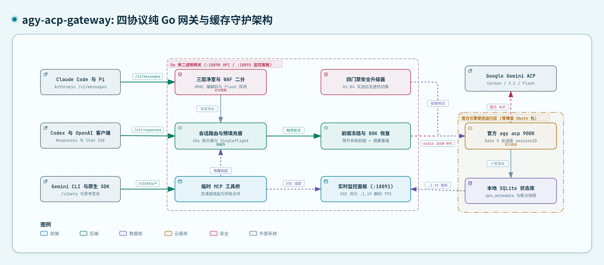
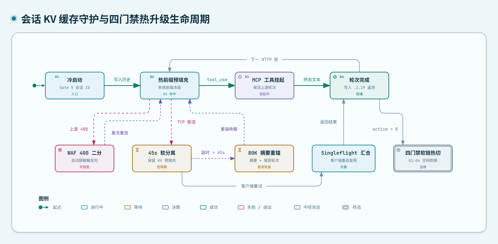
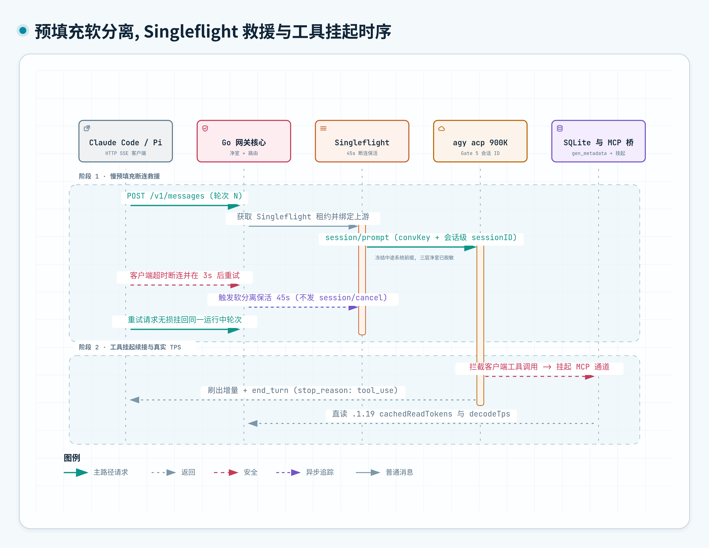

<p align="center">
  <picture>
    <source media="(prefers-color-scheme: dark)" srcset="assets/banner-zh-dark.svg" />
    
  </picture>
</p>

<h3 align="center">把官方 <code>agy acp</code> 转成标准 Anthropic <code>/v1/messages</code>、OpenAI <code>/v1/chat/completions</code> &amp; <code>/v1/responses</code> &amp; <code>/v1/images/*</code>、Google Gemini <code>/v1beta</code> 接口的单文件 Go 网关，自带多账号池与 <code>:18891</code> Web 控制台。</h3>

<p align="center">
  <a href="./README.md"><strong>English</strong></a> &nbsp;·&nbsp;
  <a href="./README_ZH.md"><strong>简体中文</strong></a> &nbsp;·&nbsp;
  <a href="#quick-start"><strong>3 分钟上手</strong></a> &nbsp;·&nbsp;
  <a href="#client-setup"><strong>客户端配置</strong></a> &nbsp;·&nbsp;
  <a href="#models"><strong>模型与多模态</strong></a> &nbsp;·&nbsp;
  <a href="#image-generation"><strong>三协议生图</strong></a> &nbsp;·&nbsp;
  <a href="#multi-account"><strong>多账号与内存</strong></a> &nbsp;·&nbsp;
  <a href="#architecture"><strong>架构与稳定性</strong></a> &nbsp;·&nbsp;
  <a href="#configuration-reference"><strong>配置与指标</strong></a> &nbsp;·&nbsp;
  <a href="#safe-upgrader"><strong>安全升级</strong></a> &nbsp;·&nbsp;
  <a href="#troubleshooting"><strong>常见问题</strong></a>
</p>

<p align="center">
  
  
  
  
  
  <a href="LICENSE"></a>
</p>

---

**`agy-acp-gateway`** 把 Google 官方 Antigravity CLI（`agy acp`，stdio JSON-RPC 2.0）封装成一个零 CGO 单文件 Go 网关（`:18890` 对外提供标准接口，`:18891` 提供多账号实时控制台）。

与逆向抓包伪造私有 OAuth/Protobuf 请求的代理不同，**所有上游请求都直接运行在官方 `agy` 二进制内部**。TLS 握手、OAuth 令牌刷新、会话轨迹和封包全部由 Google 官方客户端完成，网关在此基础上提供：

- **标准多协议接口 (`:18890`)**：同时兼容 Anthropic `/v1/messages`、OpenAI `/v1/chat/completions` 与 `/v1/responses`、Google Gemini `/v1beta`，以及 3 种生图/改图入口（`/v1/images/generations` & `/v1/images/edits`、`/v1/chat/completions`、`/v1beta/models/gemini-3.1-flash-image:generateContent`）。
- **12 个模型与全多模态支持**：包含 11 个对话模型（Gemini 4 系列、`gemini-3.8-flash`、Claude Opus/Sonnet 5.5、`gpt-oss-120b-medium`、3 款 `gemini-pro-orchestrator`）和 `gemini-3.1-flash-image` 生图模型。支持魔数校验的图片（`PNG`、`JPEG`、`WEBP`、`GIF`、`HEIC`、`HEIF`）、24 种 UTF-8 文本格式（`<=2 MiB`）、全模型可用的内置纯 Go PDF 文本提取，以及按需开启的隔离媒体中转（`AGY_MEDIA_RELAY=1`，单文件默认 `20 MiB`）支持 Gemini 扫描 PDF 与音视频。
- **多账号池与防封隔离**：单容器托管多个完全隔离的账号子进程（独立 OAuth、独立出口代理 IP、独立模型白名单、单号/分组专属 Key）。进行中的多轮对话固定留在原账号，既避免跨号重放历史触发风控，又保住 95%+ 上下文缓存。自动监测每账号 5 小时工具安全检查次数，支持面板热切预设（`80%` / `88%` / `93%` / 自定义）与多设备「共享账号」开关。
- **6 GB 小内存稳跑 20-30 个并发子代理 (`v2.3.26`)**：通过双层进程上限（`AGY_GLOBAL_IDLE_TARGET=8` 空闲保留热进程数 + `AGY_GLOBAL_BURST_MAX_LIVE_WORKERS=18` 突发并发硬顶）、工具等待会话无损温休眠（`Elastic Parked Offload`）、单进程生图引擎（单图 `243 MB` / 2 并发 `261 MB`）、瘦身子网关（`80 MiB`）与 glibc 内存分配参数，在低配 VPS 上控制内存峰值且不断缓存。

<p align="center">
  <picture>
    <source media="(prefers-color-scheme: dark)" srcset="assets/arch-overview-zh-dark.png" />
    
  </picture>
</p>

---

## 为什么用 `agy-acp-gateway`？

| 常见问题 | 简易包装 / 逆向伪造代理 | `agy-acp-gateway` 的做法 |
| :--- | :--- | :--- |
| **封号与协议指纹风险** | 伪造私有 OAuth/Protobuf 请求，或在对话中途把历史搬到另一个账号 | 100% 走官方 `agy acp` 进程；同一多轮对话固定留在原账号；每个账号独立目录和出口 IP |
| **限流与备用号切换** | 全局共用一个 `~/.gemini` 目录，遇到 `429`/`529` 只能手动停机换号 | 多账号池 5 种策略、主力/备用角色、首轮自动换号重试、按模型家族独立冷却、`VALIDATION_REQUIRED` 一键验证重检、一键排空切换 |
| **5 小时工具安全检查打满** | 免费的 `sir_flash_lite` 次数用完后静默升级到约 `80x` 扣费检查，几分钟烧光额度 | 自动统计每号 5h 检查次数，快到上限时新对话分流、超限暂停新含工具对话，纯文本请求反向走忙号省出余量 |
| **并发跑多个代理掉缓存** | 多会话共用空轨迹 ID，或中途改动 `system` / 工具列表 | 每会话独立 `SessionId`，冻结首轮系统提示与工具列表，动态工具原地更新（`TOOLS_UPDATED_IN_PLACE`） |
| **长上下文预填充断连重算** | 客户端超时断开直接发 `session/cancel`，白白扔掉 150K+ 预填充 | 预填充满 `30s` 遇断连时在后台保活 `45s`，客户端重试直接接回同一条上游流 |
| **客户端自带标签触发 400 拦截** | 直接报错，或用粗糙正则删坏用户正文 | 用会话级 `HMAC-SHA256` 无损替换敏感标签与路径并在输出流还原；遇未知 400 自动用 `gemini-3.8-flash` 二分定位 |
| **6 GB 机器并发 20+ 代理 OOM** | 进程无限常驻，内存打爆直接被系统强杀 | 空闲保 `8` 个热进程、突发允许跑到 `18` 路，长耗时工具等待自动温休眠不丢缓存，生图走单进程 |

---

<a id="quick-start"></a>

## 3 分钟快速上手

### 环境准备

- **系统**：Linux（`x86_64` / `linux_arm64`）、macOS（`darwin_arm64`），或 Windows 下的 WSL2 Ubuntu。
- **官方 Antigravity CLI (`agy`)**：已安装到 `~/.local/bin/agy`。推荐基线 **`1.5.16`**（上游 `1.5.17` 和 `1.5.18` 存在 `--agent` 模式 4 倍 Gemini 扣费 Bug；网关从不直接修改 `~/.local/bin/agy`）。
- **源码编译依赖**：Go `1.26+` 与 Python `3.10+`。

### 方式 A：Docker Compose 部署（推荐服务器与多账号使用）

```bash
# 1. 克隆仓库
git clone https://github.com/yuhxuiao/agy-acp-gateway.git
cd agy-acp-gateway

# 2. 编译零 CGO 网关二进制，并生成 --acp-only 900K 补丁版 agy
cd go-gateway && CGO_ENABLED=0 go build -trimpath -ldflags="-s -w" -o ../bin/agy-acp-gateway . && cd ..
./scripts/agy-upgrade.sh --official ~/.local/bin/agy --contract
./scripts/agy-upgrade.sh --install --candidate <上一步输出的候选目录>

# 3. 复制配置文件、填入 AGY_API_KEYS 并启动容器
cp .env.example deploy/.env
# 编辑 deploy/.env，把 AGY_API_KEYS 改成你的强密钥。
# 若容器内没有对应代理服务，保持 AGY_UPSTREAM_PROXY 注释状态即可。
docker compose -f deploy/docker-compose.yml up -d --build

# 4. 检查存活
curl -fsS http://127.0.0.1:18890/healthz
# 预期输出: {"ok":true}
```

### 方式 B：本机二进制启动 (`./scripts/gw.sh`)

```bash
# 1. 跑单测并编译二进制
cd go-gateway
gofmt -l . && go vet ./... && go test -race -count=1 ./...
CGO_ENABLED=0 go build -trimpath -ldflags="-s -w" -o ../bin/agy-acp-gateway .
cd ..

# 2. 生成并验证 ./bin/agy-acp-900k（不改动 ~/.local/bin/agy）
./scripts/agy-upgrade.sh --official ~/.local/bin/agy --contract
./scripts/agy-upgrade.sh --install --candidate <上一步输出的候选目录>

# 3. 初始化配置并启动
cp .env.example .env
# 编辑 .env：填写 AGY_API_KEYS 与 AGY_UPSTREAM_PROXY（直连填 AGY_UPSTREAM_PROXY=）
./scripts/gw.sh start
./scripts/gw.sh status
```

### 第 3 步：完成 Google 账号授权（3 种方式）

浏览器打开 `http://127.0.0.1:18891/`。HTTP Basic 登录用户名随便填，密码填 `.env` 里的 `AGY_API_KEYS`，点击顶栏 **账号**：

1. **网页免 SSH OAuth（Linux / WSL2 / Docker，推荐无头服务器与全部子账号）**：
   - *（原生 `darwin_arm64` 不支持 `/dev/ptmx` 伪终端，请改用方式 2 导入 Token JSON 或方式 3 命令行登录。）*
   - 点击 **新增账号槽位**（或在已有账号点 **网页授权**），选好出口代理（`direct`、命名预设或自定义 `http://` / `https://` / `socks5://` / `socks5h://`）并保存。
   - 点击 **第 1 步：生成 Google 授权链接**，把生成的 `https://accounts.google.com/...` 链接复制到任意本地浏览器完成登录；跳转后的 `http://localhost:.../?code=...` 页面打不开属正常现象，复制完整地址栏 URL 粘贴回 **第 2 步** 并点 **提交授权码激活**。
2. **离线导入 Token JSON**：
   - 在同一面板直接粘贴已有的 `antigravity-oauth-token` JSON 原文（`{"access_token":...,"refresh_token":...}`），点击 **直接写入 Token JSON**。
3. **命令行交互登录 *(仅主账号)***：
   - 本机：`./bin/agy-acp-900k login`
   - 容器：`docker exec -it agy-acp-gateway /app/bin/agy-acp-900k login`

### 第 4 步：发一条测试对话

```bash
curl -sS http://127.0.0.1:18890/v1/chat/completions \
  -H "Authorization: Bearer sk-your-master-key" \
  -H "Content-Type: application/json" \
  -d '{
    "model": "gemini-3.8-flash",
    "reasoning_effort": "low",
    "messages": [{"role": "user", "content": "请只回复 READY 一个词。"}]
  }'
```

---

<a id="client-setup"></a>

## 客户端接入配置（复制即用）

| 客户端 / SDK | 接口路径 | Base URL | 鉴权方式 | 会话固定与工具桥接 |
| :--- | :--- | :--- | :--- | :--- |
| **`Claude Code`** | Anthropic `/v1/messages` | `http://127.0.0.1:18890` | `x-api-key` / `ANTHROPIC_API_KEY` | `metadata.user_id` + `ws-bridge` MCP + 客户端 `WebFetch` |
| **`Codex` CLI** | OpenAI `/v1/responses` | `http://127.0.0.1:18890/v1` | `Authorization: Bearer` | `prompt_cache_key` / 首轮指纹 + 无状态历史 + MCP |
| **Cursor / Continue / `Cline` / `Roo Code` / `OpenCode`** | OpenAI `/v1/chat/completions` | `http://127.0.0.1:18890/v1` | `Authorization: Bearer` | 首轮 `(system + first_user)` 指纹 + 并行工具合并 |
| **Gemini CLI / `google-genai` SDK** | Gemini `/v1beta` | `http://127.0.0.1:18890` | `x-goog-api-key` / `?key=` | 原生 `functionCall` / `thoughtSignature` + MCP |
| **Pi Coding Agent** | `/v1/messages` 或 `/v1/responses` | `http://127.0.0.1:18890` | `x-api-key` / `Bearer` | `x-pi-session-id` + 工具原地更新 |
| **生图客户端（三协议）** | `/v1/images/*`, `/v1/chat/completions`, `/v1beta` | `http://127.0.0.1:18890` | `Bearer` / `x-api-key` / `x-goog-api-key` | 单进程 `ws-imagegen` 引擎（`gemini-3.1-flash-image`） |

### 1. `Claude Code` (`/v1/messages`)

```bash
export ANTHROPIC_BASE_URL="http://127.0.0.1:18890"
# 在主 Key 后加 @acct:<账号ID> 或 @group:<分组ID> 可直接指定账号或分组池
export ANTHROPIC_API_KEY="sk-your-master-key"
export ANTHROPIC_MODEL="gemini-4-carbon-medium"
export ANTHROPIC_SMALL_FAST_MODEL="gemini-3.8-flash-low"

claude
```

### 2. `Codex` CLI / OpenAI Responses (`/v1/responses`)

写入 `~/.codex/config.toml`：

```toml
model = "gemini-4-carbon"
model_reasoning_effort = "medium"
model_provider = "agy"

[model_providers.agy]
name = "Antigravity ACP Gateway"
base_url = "http://127.0.0.1:18890/v1"
env_key = "AGY_API_KEY"
wire_api = "responses"
```

使用 `curl` 直调：

```bash
curl -N http://127.0.0.1:18890/v1/responses \
  -H "Authorization: Bearer sk-your-master-key" \
  -H "Content-Type: application/json" \
  -d '{
    "model": "gemini-4-neon",
    "reasoning": {"effort": "high"},
    "input": "简要说明 Go sync.Pool 如何降低 GC 压力。",
    "stream": true
  }'
```

### 3. OpenAI SDK / Cursor / `Cline` (`/v1/chat/completions`)

```python
from openai import OpenAI

client = OpenAI(
    base_url="http://127.0.0.1:18890/v1",
    api_key="sk-your-master-key@group:team-pro",  # 支持主 Key、专属 Key 或 @acct:/@group: 后缀
)

resp = client.chat.completions.create(
    model="gemini-4-neon",
    reasoning_effort="high",
    messages=[
        {"role": "system", "content": "你是一名务实的系统工程师。"},
        {"role": "user", "content": "用三句话说明 Go sync.Pool 的适用边界。"},
    ],
    stream=True,
)
for chunk in resp:
    if chunk.choices and chunk.choices[0].delta.content:
        print(chunk.choices[0].delta.content, end="", flush=True)
```

### 4. Google Gemini CLI 与 `google-genai` SDK (`/v1beta`)

```bash
export GOOGLE_GEMINI_BASE_URL="http://127.0.0.1:18890"
export GEMINI_API_KEY="sk-your-master-key"

curl -sS "http://127.0.0.1:18890/v1beta/models/gemini-4-hydrogen:generateContent" \
  -H "x-goog-api-key: ${GEMINI_API_KEY}" \
  -H "Content-Type: application/json" \
  -d '{
    "contents": [{"role": "user", "parts": [{"text": "用三条要点总结 Raft 选主流程。"}]}],
    "generationConfig": {"thinkingConfig": {"thinkingLevel": "XHIGH"}}
  }'
```

---

<a id="models"></a>

## 支持的 12 个模型、思考档位与多模态

### 11 个对话模型 + 1 个生图模型 (`agy 1.5.14+`)

| 模型 ID | 家族 | 所属额度池 | 上下文窗口 | 最大图片数 | 思考档位 | 内置别名 |
| :--- | :--- | :--- | :--- | :--- | :--- | :--- |
| **`gemini-4-carbon`** *(默认)* | `gemini` | Gemini 池 | `1,048,576` (`900K` 安全区) | `200` | `low`, `medium`, `high` (`xhigh` -> `high`) | `carbon` |
| **`gemini-4-neon`** | `gemini` | Gemini 池 | `1,048,576` (`900K` 安全区) | `200` | `low`, `medium`, `high`, **`xhigh`** *(原生)* | `neon` |
| **`gemini-4-argon`** | `gemini` | Gemini / Argon 池 | `1,048,576` (`900K` 安全区) | `200` | `low`, `medium`, `high` (`xhigh` -> `high`) | `argon` |
| **`gemini-4-hydrogen`** | `gemini` | Gemini 池 | `1,048,576` (`900K` 安全区) | `200` | `low`, `medium`, `high`, **`xhigh`** *(原生)* | `hydrogen` |
| **`gemini-3.8-flash`** | `gemini` | Gemini 池 | `1,048,576` (`900K` 安全区) | `200` | `low`, `medium`, `high` (`xhigh` -> `high`) | `gemini-flash`, `gemini-2.5-flash*`, `gemini-3-flash*`, `gemini-3.0-flash*` |
| **`claude-opus-5-5`** | `claude` | 第三方 (`Claude`/GPT) 池 | `1,048,576` (`900K` 安全区) | `100` | `low`, `medium`, `high` (`xhigh` -> `high`) | `agy-opus` *(设 `AGY_ROUTE_CLAUDE_NAMES=1` 含 `*opus*`)* |
| **`claude-sonnet-5-5`** | `claude` | 第三方 (`Claude`/GPT) 池 | `1,048,576` (`900K` 安全区) | `100` | `low`, `medium`, `high` (`xhigh` -> `high`) | `agy-sonnet` *(设 `AGY_ROUTE_CLAUDE_NAMES=1` 含 `*sonnet*`)* |
| **`gpt-oss-120b-medium`** | `gpt` | 第三方 (`Claude`/GPT) 池 | `131,072` (`128K`) | `100` | **固定 `medium`** | `gpt-oss`, `gpt-oss-120b` |
| **`gemini-pro-orchestrator`** | `gemini` | Gemini 池 | `1,048,576` (`900K` 安全区) | `200` | **固定 `high`** | `gemini-pro-orchestrator*` |
| **`gemini-pro-orchestrator-neon`** | `gemini` | Gemini 池 | `1,048,576` (`900K` 安全区) | `200` | **固定 `high`** | `gemini-pro-orchestrator-neon*` |
| **`gemini-pro-orchestrator-argon`** | `gemini` | Gemini 池 | `1,048,576` (`900K` 安全区) | `200` | **固定 `high`** | `gemini-pro-orchestrator-g1-pro` |
| **`gemini-3.1-flash-image`** | `gemini` | Gemini 池 | 图像生成 / 参考图编辑 | `3` 张参考图 | 无 | `gemini-3.1-flash-image-preview` |

- **模型列表与严格协议契约**：`GET /v1/models` 和 `GET /v1beta/models` 会按当前 Key 的账号/分组白名单过滤并返回窗口元数据（`max_input_tokens`、`max_tokens`）。所有协议统一支持 JSON Schema 结构化输出（`output_config.format`、`response_format`、`text.format`、`responseJsonSchema`）。`/v1/responses` 传入无效续接 ID 时明确返回 `previous_response_not_found` 或 `thread_not_found`。
- **固定档位与别名处理**：固定档位模型（`gpt-oss-120b-medium`、`gemini-pro-orchestrator*`）自动跳过 `thought_level` 设置，避免上游 `-32602` 报错。模型名会自动剥离 `models/`、`[1m]` 与思考档位后缀（`-minimal`、`-low`、`-medium`、`-high`、`-xhigh`、`-max`、`-ultra`）。需要把通用 `*opus*` / `*sonnet*` / `*haiku*` 映射到对应模型时，设 `AGY_ROUTE_CLAUDE_NAMES=1`；需要在模型列表中展开档位后缀时，设 `AGY_EXPOSE_TIER_MODELS=1`。
- **套餐额度自动识别**：通过 `<agy> -p /usage` 和 `/credits` 自动区分 **Google AI Pro**（Gemini `$10` 5h / `$35` 7d，第三方 `$2.50` / `$5`，独立 Argon 周池）、**Google AI Ultra 5x**（`ultra_5x`，保留真实剩余比例）和 **Google AI Ultra 20x**（Gemini `$200` 5h / `$800` 7d，第三方 `$25` / `$50`）。也可在 `:18891` 或 `AGY_ACCOUNT_PLAN_TIER_OVERRIDE` 手动指定档位。

### 思考档位统一映射

请求体参数优先级高于模型名后缀（如 `gemini-4-neon-xhigh`），未指定时默认 `medium`：

| 网关档位 | 模型名后缀 | OpenAI (`reasoning_effort` / `reasoning.effort`) | Anthropic (`thinking.budget_tokens` / `output_config.effort`) | Gemini `/v1beta` (`thinkingLevel` / `thinkingBudget`) |
| :--- | :--- | :--- | :--- | :--- |
| **`low`** | `-minimal`, `-low` | `none`, `minimal`, `low` | `type: "disabled"`、`<= 4096` 或 `low` | `NONE`, `MINIMAL`, `LOW` 或 `0..4096` |
| **`medium`** *(默认)* | `-medium` | `medium` *(或缺省)* | `4097..16384` 或 `medium` | `MEDIUM` 或 `4097..16384` |
| **`high`** | `-high` | `high` | `16385..32768` 或 `high` | `HIGH` 或 `16385..32768` |
| **`xhigh`** *(Neon / Hydrogen)* | `-xhigh`, `-max`, `-ultra` | `xhigh`, `max`, `ultra` | `> 32768` 或 `xhigh`/`max` | `XHIGH`, `MAX`, `ULTRA` 或 `> 32768` |

---

<a id="image-generation"></a>

### 三协议生图与改图 (`gemini-3.1-flash-image`)

3 种调用入口全部走同一个账号/分组白名单（`gemini-3.1-flash-image`），底层共用单进程 `agy acp --agent ws-imagegen` 引擎（`0` MCP 服务器、`0` 次工具安全检查，响应头返回 `X-Agy-Served-Model: gemini-3.1-flash-image`）：

- **真实支持的能力上限**：
  - **7 种画幅比例**：`1:1`（`1024x1024`）、`2:3`（`848x1264`）、`3:2`（`1264x848`）、`3:4`（`896x1200`）、`4:3`（`1200x896`）、`9:16`（`768x1376`）、`16:9`（`1376x768`），或 OpenAI `size`（`1024x1024`、`1536x1024`、`1024x1536`、`1792x1024`、`1024x1792`、`auto`）。这 7 种比例是 `agy` 后端的真实上限。
  - **参考图编辑 (`1..3` 张)**：支持魔数校验的 `PNG`、`JPEG`、`WEBP`、`GIF`、`HEIC`、`HEIF`（单张 `<=10 MiB`）。
  - **批量出图 (`n=1..4`)**：单进程内最多 2 路并发出图（峰值内存 `261 MB`，原多进程需 `662 MB`）；当容器内存达到告警水位时自动降为串行。
  - **输出格式 (`output_format: "jpeg" | "png"`)**：默认 `"jpeg"` 零解码直出；显式传 `"png"` 时逐张串行转为真 PNG。
- **内存与自动回收**：关闭 `--process-per-session` 后单图峰值从 `415 MB` 降到 `243 MB`。空闲 `45s` 自动停机（内存告警缩至 `10s`，高压立即归 `0s` 释放），累计生成 `40` 张、存活满 `20` 分钟或连续报错 `2` 次时自动排空重启并清理一次性 `.db` 文件。

#### 入口 1：OpenAI `/v1/images/generations` 与 `/v1/images/edits`

```bash
# 文生图（返回 b64_json 与 output_format）
curl -sS http://127.0.0.1:18890/v1/images/generations \
  -H "Authorization: Bearer sk-your-master-key" \
  -H "Content-Type: application/json" \
  -d '{
    "model": "gemini-3.1-flash-image",
    "prompt": "暖纸风格的 Go API 网关等距技术架构插画",
    "aspect_ratio": "16:9",
    "n": 2,
    "output_format": "jpeg",
    "response_format": "b64_json"
  }'

# 图生图编辑（支持 1..3 张参考图；multipart/form-data 与 JSON base64 均支持）
curl -sS http://127.0.0.1:18890/v1/images/edits \
  -H "Authorization: Bearer sk-your-master-key" \
  -F "model=gemini-3.1-flash-image" \
  -F "prompt=把草图转成暖光清晰的工程线稿" \
  -F "aspect_ratio=3:2" \
  -F "output_format=png" \
  -F "image[]=@./ref1.png"
```

#### 入口 2：OpenAI `/v1/chat/completions`

传入 `model: "gemini-3.1-flash-image"`（支持 `stream: false` 与 `stream: true`，可选 `aspect_ratio` / `size` / `n` / `output_format`，以及最多 3 张 `image_url` 参考图）。图片以标准 Markdown `` 返回在 `choices[0].message.content`：

```bash
curl -sS http://127.0.0.1:18890/v1/chat/completions \
  -H "Authorization: Bearer sk-your-master-key" \
  -H "Content-Type: application/json" \
  -d '{
    "model": "gemini-3.1-flash-image",
    "aspect_ratio": "4:3",
    "output_format": "jpeg",
    "messages": [
      {"role": "user", "content": "画一张浅木桌面上的机械键盘与手冲咖啡特写"}
    ]
  }'
```

#### 入口 3：原生 Google Gemini `/v1beta`

支持 `:generateContent` 与 `:streamGenerateContent?alt=sse`、`generationConfig.imageConfig.aspectRatio`、`candidateCount`（`1..4`）、`responseMimeType: "image/png"`，多轮 `contents` 自动提取最近最多 3 张 `inlineData` 参考图，返回标准 `candidates[].content.parts[].inlineData`：

```bash
curl -sS "http://127.0.0.1:18890/v1beta/models/gemini-3.1-flash-image:generateContent" \
  -H "x-goog-api-key: sk-your-master-key" \
  -H "Content-Type: application/json" \
  -d '{
    "contents": [{"role": "user", "parts": [{"text": "浅木桌面上的银色 USB-C 扩展坞产品图"}]}],
    "generationConfig": {
      "candidateCount": 1,
      "imageConfig": {"aspectRatio": "16:9"}
    }
  }'
```

### 图片、PDF 与音视频多模态

- **图片与文本文档**：支持魔数校验的 `PNG`、`JPEG`（自动剥离灰度 JPEG 的 Adobe APP14 标记，修复上游 `400`）、`WEBP`、`GIF`、`HEIC`、`HEIF`（单图 `<=10 MiB`，单轮 `<=32 MiB`），远程拉图拦截私网 IP 防 SSRF；另支持 24 种 UTF-8 文本格式（`<=2 MiB`）。
- **文本型 PDF (`AGY_PDF_TEXT_FASTPATH=1`，默认开启)**：内置纯 Go PDF 文本解析，**所有模型**（含 Claude 和 GPT）以及含工具回合都直接可用，不影响 MCP 工具和上下文缓存。
- **扫描版 PDF、音频与视频 (`AGY_MEDIA_RELAY=1`，按需开启)**：默认关闭（`AGY_MEDIA_RELAY=0`）。开启后，Gemini 无工具对话可通过隔离沙盒进程 `ws-media`（`"toolPermission": "strict"` 同步开盘前路径白名单、`0` 次安全检查、回合结束自动清理暂存）读取扫描 PDF、音频（`wav`、`mp3`、`m4a`、`ogg`、`flac`、`opus`、`aac`、`webm`、`amr`）和视频（`mp4`、`webm`、`mov`、`3gp`、`m4v`）。
  - **体积与数量上限**：单文件默认 **`20 MiB`**（`AGY_MEDIA_RELAY_MAX_BYTES=20971520`，硬顶 `25 MiB`，解码前超限直返 HTTP `413`），单次默认 `3` 个文件（硬顶 `5` 个）。非 Gemini 模型或未开启 `AGY_MEDIA_RELAY=1` 时明确返回 HTTP `400`。

---

<a id="multi-account"></a>

## 多账号池、防封机制与 6 GB 内存高并发管理

### 1. 单容器隔离沙盒、出口代理与渠道分组

在 `:18891` 添加的每个子账号都有独立运行目录（`<data_dir>/accounts/<id>/`）和本地回环子网关（`127.0.0.1:28902+`）：

- **完全隔离**：独立 `HOME`、OAuth 凭据（`0600`）、工作区、`gateway.db`、日志，以及独立的辅助数据目录（`antigravity-cli-usage`、`antigravity-cli-imagegen`、`media-home`）。
- **独立出口代理**：每个账号单独选 `direct`（直连）、命名预设（`AGY_PROXY_PRESETS_FILE` + `AGY_RESIN_HOST` / `AGY_RESIN_PROXY_TOKEN`，缺令牌时直接阻断防漏宿主机 IP）或自定义 `http://` / `https://` / `socks5://` / `socks5h://`。
- **5 种分配策略**（全局可配，也可按渠道分组 `AccountGroup` 覆盖）：
  - `round-robin` *(默认)*：健康账号均匀轮询，同时按剩余工具检查次数均衡。
  - `fill-first`：优先使用优先级数值（`1..1000`）更小的账号。
  - `weighted-rr`：平滑加权轮询（`weight` `1..100`，适合 Ultra `20x` 和 Pro 混用）。
  - `least-load`：综合在途并发和剩余额度挑最空闲的账号。
  - `manual-active`：新对话固定走指定账号，可勾选不可用时自动换备选号。
- **备用号角色**：把账号角色设为 `standby` 后，主力号健康时它保持待命，只在主力号满载或不可用时接管。

| 指定方式 | 客户端写法 | `:18891` 控制台权限 | 模型白名单 |
| :--- | :--- | :--- | :--- |
| **单号专属 Key** | `Authorization: Bearer sk-acct-only-key` | 拒绝 (`401`) | 账号 `allowedModels` |
| **分组专属 Key** | `Authorization: Bearer sk-team-group-key` | 拒绝 (`401`) | 分组 `allowedModels` ∩ 账号 `allowedModels` |
| **主 Key + 账号后缀** | `<master_key>@acct:<id>` 或 `<master_key>@<id>` *(亦支持 `#`)* | 仅限 `:18890` 接口 | 账号 `allowedModels` |
| **主 Key + 分组后缀** | `<master_key>@group:<group_id>` *(亦支持 `#group:<group_id>`)* | 仅限 `:18890` 接口 | 分组 `allowedModels` ∩ 账号 `allowedModels` |
| **显式请求头** | `X-Agy-Account: <id>` 或 `X-Agy-Group: <group_id>` *(配主 Key)* | 主 Key 权限 | 账号不在分组内时直接返回 `403` |
| **默认全局池** | `<master_key>` | 主 Key 权限 | 命中账号的 `allowedModels` |

响应头统一回传：`X-Agy-Account`、`X-Agy-Group`、`X-Agy-Route-Mode`、`X-Agy-Failover-Count`、`X-Agy-Served-Model`、`X-Agy-Cache-Warning`。

### 2. 为什么同一段多轮对话必须固定在原账号？

```text
  [全新对话第 1 轮] ([system, user_1])
         |
         +--> 选中账号 A --> 输出首字前遇 429 / 529 / 502 / 503 / 401(#3501)?
         |                        | 是 (最多换号重试 2 次)
         |                        v
         |                账号 A 进入冷却 + 自动换健康账号 B 重发首轮
         |                        |
         +--> 账号 B 接单成功 --> 记住这条对话固定走账号 B
                                  + 返回 X-Agy-Account: B, X-Agy-Failover-Count: 1

  [进行中的多轮续接] (第 2 轮及以后 / tool_result)
         |
         +--> 始终留在账号 B (即使 B 在排空或接近检查上限)。
              常规错误绝不把几十轮工具历史搬到别的个人号重放。
              (仅在开启 AGY_MONITOR_TRIP_HOP 且 B 触发真实 429 检查锁定时才换号。)
```

把一个带几十次工具调用的编程对话中途从账号 A 搬到账号 B，会瞬间把上下文缓存从 95%+ 归零，还容易制造异常跨号历史触发风控。因此负载均衡与自动换号重试只发生在**第 1 轮**，**第 2 轮起**按会话 ID、`prompt_cache_key` 或首轮 `(system + first_user)` `SHA-256` 指纹固定在原账号。

### 3. 5 小时工具安全检查次数管理

官方 `agy` 在每次调用外部 MCP 工具前，会先跑一次免费安全检查（`sir_flash_lite`）。如果单号 5 小时免费次数用光触发 `429`，`agy` 会把每次工具调用升级到约 `80x` 费用的重型检查，几分钟就能把 5 小时 Gemini 额度烧空。

网关直接从进程日志里被动统计每号次数并做保护：
- **面板热切预设（免重启）**：提供 **保守 `80%`**（Ultra `2800/3800/4800`，Pro `1800/2600/3400`）、**均衡 `88%`** *(默认：Ultra `3300/4250/4800`，Pro `2100/2900/3400`)*、**跑满 `93%`**（Ultra `3600/4450/4800`，Pro `2300/3100/3400`）和 **自定义**。
- **按重置剩余时间自动放宽**：离 5 小时重置越近且剩余次数充足时，自动放宽拦截线，避免白白浪费未用完的检查次数。
- **保缓存停分**：触及停分线时默认只停分**新**含工具对话，老对话继续留在原号不断连、不丢缓存（是否连旧对话一起换号默认关闭，可在面板勾选）。
- **纯文本反向分流**：不含工具的对话不耗安全检查次数，会优先分给检查余量较少的账号，把检查余量留给编程代理。
- **共享账号开关 (`ignoreBurnAnomaly`)**：同一个 Google 账号如果同时在别的电脑或桌面端用，在 `:18891` 账号编辑里打开 **共享账号**，就会忽略「实际扣费高于网关统计」的提醒。

### 4. 6 GB 小内存机器怎么稳跑 20-30 个并发子代理 (`v2.3.26`)

单个存活的 `agy` 进程会占约 `150-240 MB` 私有内存，如果 20-30 个子代理全部常驻，6 GB 服务器很快就会 OOM。`v2.3.26` 通过四层机制把内存压稳：

1. **双层并发上限 (`AGY_GLOBAL_IDLE_TARGET=8`, `AGY_GLOBAL_BURST_MAX_LIVE_WORKERS=18`)**：
   - `AGY_GLOBAL_IDLE_TARGET`（默认 `8`，未配置时回退读取 `AGY_GLOBAL_MAX_LIVE_WORKERS`）：平时空闲保留的热进程数量。
   - `AGY_GLOBAL_BURST_MAX_LIVE_WORKERS`（未配置时按容器内存自动推导，例如 6 GB 容器为 `18`）：突发高并发时的全池硬顶。
   - 主力账号配到 `12-16` 路时不再被 `8` 锁死：突发期间单号可以跑满 `12-16` 路（只要全池不超过 `18` 路），忙完后自动休眠缩回 `8` 个热进程省内存。
   - 新增同步准入闸门（`/api/internal/global-admit`）：新拉进程前按优先级驱逐多余空闲进程（一次性探针 -> 空闲生图进程 -> `<32K` 空闲 -> 可休眠的工具等待 -> `32K-100K` 空闲 -> `>=100K` 大上下文最后动），如果全部都在推理则短等队列（最长 `12s`）。
2. **工具等待会话无损温休眠 (`Elastic Parked Offload`)**：
   - 子代理跑 `Bash` 编译或等下级代理返回时，短工具享 `15s` 热保活（读文件/改代码零唤醒开销）。
   - 全池超水位（活进程 > `8` 或内存 `>= 65%`）时，把长命令等待（`>=15s`）或任意工具挂起 `>=45s` 的 `<64K` 会话先关闭上游进程再转温休眠，同时把工具名、参数摘要和错误状态写进 `gateway.db`。结果回来时自动 `session/resume` 接上，保住 `98%+` 上下文缓存，还省下 `~200 MB` 内存和多余的保活检查次数。
3. **单进程生图引擎**：
   - `ws-imagegen` 改为单进程模式（单图 `243 MB`、2 并发 `261 MB`，原多进程 `662 MB`），多账号池里优先复用最近刚生过图的热账号，容器高压时立即停机释放。
4. **瘦身子网关与 glibc 内存限制**：
   - 子账号网关默认 `GOMEMLIMIT=80MiB`、`GOGC=25`、`AGY_IMAGE_CACHE_MAX_MB=4`，额度轮询改走轻量 `/api/internal/quota-lite`（子网关内存从 `~125 MB` 降到 `~40 MB`）。
   - 所有 `agy` 子进程默认注入 `MALLOC_ARENA_MAX=2`、`MALLOC_TRIM_THRESHOLD_=65536`、`MALLOC_MMAP_THRESHOLD_=65536`，单进程实省 `20-35 MB` 内存。

### 5. 按模型家族独立冷却、`VALIDATION_REQUIRED`、OAuth 宽限与一键切换

- **三家族独立冷却**：`429` 与 `529` 按 `gemini`、`claude`（含 GPT）和 `argon` 独立计时。Claude 限流时，Gemini 照常接单。
- **Google 验证状态 (`VALIDATION_REQUIRED`)**：单独标为 `需要验证`（绝不误判为封号）。`:18891` 横幅与卡片直接提供 **前往验证** 和 **已验证, 重检**（`health_check`）。
- **每小时 OAuth 刷新 `401` 宽限**：遇到单次瞬时 `401` 先在回合内短重试 1 次，并仅施加 `30s` 宽限冷却加异步复探，连续失败才隔离账号。
- **一键运维动作 (`POST /api/accounts/action`)**：支持 `rotate_next`（轮转下一号）、`drain_and_rotate`（旧号停接新对话、老对话跑完，新流量立刻切下一号）和 `health_check`。

---

<a id="architecture"></a>

## 稳定性、缓存保护与 `:18891` 控制台

<p align="center">
  <picture>
    <source media="(prefers-color-scheme: dark)" srcset="assets/lifecycle-cache-zh-dark.png" />
    
  </picture>
  &nbsp;
  <picture>
    <source media="(prefers-color-scheme: dark)" srcset="assets/seq-prefill-zh-dark.png" />
    
  </picture>
</p>

1. **上下文缓存保护与断连救援**：
   - 核验 `agy 1.5.14+` 原生 `SessionId` 透传并解锁 `900K` 上下文，多并发会话互不串缓存。
   - 冻结首轮 `system`/`developer` 提示与工具列表，动态挂载 MCP 工具时通过 `TOOLS_UPDATED_IN_PLACE` 原地更新。
   - 预填充耗时 `>=30s` 时若客户端断开，后台保活 `45s`（`AGY_PREFILL_CANCEL_MIN_ELAPSED_SEC=30` / `AGY_PREFILL_CANCEL_GRACE_SEC=45`），重试请求直接接回同一条流。
2. **本地回环 MCP 工具桥 (`ws-bridge`)**：
   - 通过仅监听本地回环的 Streamable HTTP MCP 桥（`/mcp/{tenantKey}`）转发客户端工具调用，开启 `inheritCustomizations: false` 与严格 `allowedTools` 校验。
   - 支持把工具返回的图片经 `ImageContentBlock` 送给模型，对超长文本做 UTF-8 70/30 首尾预截断（`AGY_MCP_TOOL_RESULT_MAX_BYTES=9600`，避开上游 `10,240B` 静默截断），合并并行工具调用，并透传带 schema 的客户端 `WebFetch`（搜索直接走内置 `search_web`）。
3. **可逆脱敏与 WAF 自动二分**：
   - 用会话级 `HMAC-SHA256` 令牌（`reversible_codec.go`）替换客户端内部标签与本机路径，输出流实时还原。
   - 遇未知上游 `400` 拦截时自动用 `gemini-3.8-flash` 二分定位触发段落并保存最小规则（`AGY_WAF_AUTOBISECT=true`）。
4. **流式超时、有界 SQLite 与 `<2s` 停机**：
   - 分离首字等待超时（`AGY_PROMPT_FIRST_CHUNK_TIMEOUT_SEC=360`）与流间空闲超时（`AGY_PROMPT_STREAM_IDLE_TIMEOUT_SEC=180`），熔断 `\r` 死循环输出（`AGY_RUNAWAY_CR_MAX_CONSECUTIVE=4096`），损坏轨迹即时换槽。
   - 纯 Go 零写锁读取 `agy` 的 SQLite + WAL 提取精确缓存/思考/输出 Token（`internal/store/sqlite_protobuf.go`），超过 8 天的数据自动汇总并每日压缩，停机耗时 `<2s`。
5. **双端口隔离与内置 Web 控制台 (`:18891`)**：
   - `:18890` 只暴露 AI 接口和 `/healthz`（访问 `/`、`/api/*`、`/metrics` 均返回 `404`）；`:18891` 只服务主 Key 鉴权的控制台、账号管理与 `/metrics`（访问 `/v1/*`、`/v1beta/*`、`/mcp/*` 均返回 `404`）。
   - HTML、CSS、JavaScript 与 Lucide 图标全部打包在单文件二进制内（设计规范见 [`DESIGN.md`](DESIGN.md)），支持可折叠额度条、12 模型白名单、工具安全检查预设、实时 cgroup 内存与热进程/突发指示条、多节点联邦（`AGY_DASHBOARD_PEERS`）和一键升级审批。

---

<a id="configuration-reference"></a>

## 接口、环境变量与 Prometheus 指标

### 端口与接口列表

| 服务端口 | 方法与路径 | 鉴权要求 | 说明 |
| :--- | :--- | :--- | :--- |
| **数据面 `:18890`** | `GET /healthz` | 免鉴权 | 存活探针（`{"ok":true}`） |
| **数据面 `:18890`** | `GET /v1/models`, `GET /v1beta/models` | API Key（主 Key / 专属 Key / `?key=`） | 按白名单过滤的 12 模型列表（含 `max_input_tokens` / `max_tokens`） |
| **数据面 `:18890`** | `POST /v1/messages`, `POST /v1/messages/count_tokens` | `x-api-key` 或 `Bearer` | Anthropic Messages 接口（流式/非流式/工具/图片/PDF/音视频/思考） |
| **数据面 `:18890`** | `POST /v1/chat/completions` | `Authorization: Bearer` | OpenAI Chat Completions（对话模型 + `gemini-3.1-flash-image` 生图） |
| **数据面 `:18890`** | `POST /v1/responses` | `Authorization: Bearer` | OpenAI Responses 接口（`Codex` CLI） |
| **数据面 `:18890`** | `POST /v1/images/generations`, `POST /v1/images/edits` | `Authorization: Bearer` 或 `x-api-key` | OpenAI 生图/改图接口（`gemini-3.1-flash-image`、`n=1..4`、`1..3` 参考图、`jpeg`/`png`） |
| **数据面 `:18890`** | `POST /v1beta/models/{m}:generateContent` / `:streamGenerateContent` / `:countTokens` | `x-goog-api-key`、`Bearer` 或 `?key=` | Google Gemini 原生 REST v1beta（对话模型 + `gemini-3.1-flash-image`） |
| **管理面 `:18891`** | `GET /`, `GET /api/dashboard`, `GET /api/quota` | 仅主 Key（Basic/Bearer/`x-api-key`） | Web 控制台、多节点联邦与额度快照 |
| **管理面 `:18891`** | `GET /metrics` | 仅主 Key | Prometheus `0.0.4` 网关与账号指标 |
| **管理面 `:18891`** | `GET/POST/DELETE /api/accounts`, `/routing`, `/groups`, `/action`, `/probe-ip`, `/oauth/*` | 仅主 Key + CSRF（`X-Agy-Requested-With: dashboard`） | 账号沙盒、渠道分组、路由设置、轮转、探活与网页 OAuth |
| **管理面 `:18891`** | `GET /api/upgrade`, `POST /api/upgrade/approve` | 仅主 Key + CSRF | `G1-G5` 上游 `agy` 升级状态与一键确认 |

### 核心环境变量速查表 (`.env`)

默认值与 `go-gateway/internal/config/snapshot.go`、`go-gateway/session_runner.go`、`go-gateway/mcp_bridge.go` 及 `deploy/prod-upgrader/agy_prod_upgrader.py` 一致：

| 变量名 | 默认值 | 说明 |
| :--- | :--- | :--- |
| `AGY_API_KEYS` | *(本地回环可空)* | 逗号分隔主管理 Key，保护 `:18890` 与 `:18891`（支持 `@acct:<id>` / `@group:<id>`） |
| `AGY_LISTEN_HOST` | `127.0.0.1` | 监听地址（`deploy/docker-compose.yml` 容器内设为 `0.0.0.0`） |
| `AGY_GW_PORT` / `AGY_DASH_PORT` | `18890` / `18891` | 数据面 API 端口与管理面控制台/监控端口 |
| `AGY_ACCOUNTS_FILE` | `<data>/accounts.json` | 账号、渠道分组、备用角色与路由设置文件路径 |
| `AGY_PROXY_PRESETS_FILE` / `AGY_RESIN_HOST` / `AGY_RESIN_PROXY_TOKEN` | *(可选)* / `resin:2260` / *(空)* | 命名出口代理预设 JSON 与中转主机/令牌 |
| `AGY_DASHBOARD_PEERS` | *(可选)* | 跨机多节点联邦面板配置（`id\|label\|url\|key;...`） |
| `AGY_UPSTREAM_PROXY` | *(空；`gw.sh` 默认 `http://127.0.0.1:7890`)* | 主账号默认 HTTP/HTTPS/SOCKS5 出口代理 |
| `AGY_MAX_LIVE_WORKERS` | `8` | 主账号单号最大并发进程数 |
| `AGY_GLOBAL_IDLE_TARGET` / `AGY_GLOBAL_MAX_LIVE_WORKERS` | `8` *(Compose；`0` 自动)* | 全池空闲保留热进程数（`AGY_GLOBAL_IDLE_TARGET` 未设时回退读取 `AGY_GLOBAL_MAX_LIVE_WORKERS`） |
| `AGY_GLOBAL_BURST_MAX_LIVE_WORKERS` | *按内存自动推导（6 GB 为 `18`）* | 全池突发高并发时的存活进程硬顶 |
| `AGY_MAX_CONCURRENT_PROMPTS` | `clamp(workers, 6, 16)` | 单网关并发推理上限 |
| `AGY_IDLE_WORKER_TTL_SEC` / `AGY_ENGINE_IDLE_GRACE_SEC` | `180` / `180` | 空闲进程休眠超时（`3m`）与共享引擎空闲保活（`3m`） |
| `AGY_MEM_PRESSURE_WARN_PCT` / `AGY_MEM_PRESSURE_HIGH_PCT` | `70` / `80` | cgroup v2/v1 工作集内存压力阈值（%），触发跨号 LRU 休眠 |
| `AGY_IMAGE_CACHE_MAX_MB` | `16` *(子网关 `4`)* | 远程拉图内存缓存上限 MiB（`0` 关闭） |
| `AGY_PROMPT_IDLE_TIMEOUT_SEC` / `AGY_PROMPT_MAX_DURATION_SEC` | `1800` / `43200` | 活跃感知空闲超时（`30m`）与单回合上限（`12h`） |
| `AGY_PROMPT_FIRST_CHUNK_TIMEOUT_SEC` / `AGY_PROMPT_STREAM_IDLE_TIMEOUT_SEC` | `360` / `180` | 分离流式超时：首字等待（`6m`）与流间空闲（`3m`） |
| `AGY_MCP_TOOL_RESULT_MAX_BYTES` / `AGY_RUNAWAY_CR_MAX_CONSECUTIVE` | `9600` / `4096` | MCP `tool_result` UTF-8 70/30 首尾截断上限与 `\r` 死循环熔断（`0` 关闭） |
| `AGY_PARKED_TTL_SEC` / `AGY_MAX_TOOL_RELAYS` / `AGY_TOOL_RELAY_SEC` | `300` / `2` / `55` *(自适应)* | 工具等待超时（`5m`）、空回合接力上限（`2`）与自适应保活间隔（`55s-150s`） |
| `AGY_PDF_TEXT_FASTPATH` / `AGY_MEDIA_RELAY` | `1` / `0` | 纯 Go 文本 PDF 提取（`1` 全模型默认开）与可选 `ws-media` 扫描 PDF/音视频沙盒（`1` 开启） |
| `AGY_MEDIA_RELAY_MAX_BYTES` / `MAX_FILES` / `MAX_CONCURRENCY` | `20971520` / `3` / `1` | 媒体中转单文件上限（`20 MiB`，硬顶 `25 MiB`，解码前 `413`）、单次文件数（硬顶 `5`）与全局并发 |
| `AGY_MONITOR_TRIP_ROUTING` / `AGY_MONITOR_TRIP_HOP` / `AGY_MONITOR_BUDGET_SPREAD` | `true` / `true` / `true` | 5h 工具安全检查改道、429 换号与剩余次数均衡 |
| `AGY_MONITOR_SOFT_CAP_ULTRA` / `DRAIN` / `HARD` | `3300` / `4250` / `4800` | Ultra `20x` 5h 工具检查 `balanced`（`88%`）默认次数线 |
| `AGY_MONITOR_SOFT_CAP_PRO` / `DRAIN` / `HARD` | `2100` / `2900` / `3400` | Pro 与 Ultra `5x` 5h 工具检查 `balanced`（`88%`）默认次数线 |
| `AGY_ACCOUNT_PLAN_TIER_OVERRIDE` | *(空 = 自动)* | 手动指定主账号套餐档位（`pro` \| `ultra_5x` \| `ultra`） |
| `AGY_PREFILL_CANCEL_MIN_ELAPSED_SEC` / `AGY_PREFILL_CANCEL_GRACE_SEC` | `30` / `45` | 慢预填充断连保活触发阈值（`30s`）与保活窗口（`45s`） |
| `AGY_CAPACITY_FALLBACK_TTL_SEC` / `AGY_CAPACITY_FALLBACK_MAX_TTL_SEC` | `300` / `1800` | 自动降档后尝试恢复的冷却时长与退避上限（`0` 为本会话不再升回） |
| `AGY_WAF_AUTOBISECT` | `true` | 上游 `400` 误拦截自动用 Flash 二分定位规则 |
| `AGY_CONV_KEEP_DAYS` / `AGY_ACP_LOG_KEEP_DAYS` / `AGY_ACP_LOG_MAX_MB` | `0` (`4` Compose) / `0` (`7` Compose) / `64` | 会话与进程日志留存天数及单号日志体积上限（保留近 24h） |
| `AGY_VERIFY_DEFER_BACKOFF_SECS` | `900,1800,3600` | 宿主机升级代理遇全池 `429` 时的延后验收间隔（`15m`/`30m`/`60m`） |
| `AGY_BLOCKED_VERSIONS` | `1.5.17,1.5.18` | 宿主机升级代理拦截已知回归版本黑名单（设 `""` 或 `none` 覆写） |
| `AGY_SKIP_G5_MEDIA_CHECK` | `0` | 离线校验 `ws-media` 严格权限门禁（`1` 仅作应急跳过） |

完整带注释配置模板见 [`.env.example`](.env.example)。

### 核心 Prometheus 指标 (`GET :18891/metrics`)

- **网关与缓存**：`agy_gateway_store_ready`、`agy_gateway_live_workers`、`agy_gateway_max_live_workers`、`agy_gateway_hibernated_sessions`、`agy_gateway_parked_calls`、`agy_gateway_prompts_inflight`、`agy_gateway_max_concurrent_prompts`、`agy_gateway_requests_total`、`agy_gateway_cache_burn_warnings_total`、`agy_gateway_capacity_fallback_active_sessions`、`agy_gateway_soft_detach_total{outcome}`、`agy_gateway_upgrade_state{state}`、`agy_gateway_turns_total{model,mode,stop_reason,usage_source}`、`agy_gateway_tokens_total{model,kind}`。
- **多账号池**：`agy_account_inflight{account,state}`、`agy_account_sticky_sessions{account}`、`agy_account_cooldown_seconds{account}`、`agy_account_requests_total{account}`、`agy_account_failures_total{account}`、`agy_account_rate_limits_total{account}`、`agy_account_failovers_total{account}`、`agy_account_worker_up{account}`、`agy_account_live_workers{account}`、`agy_account_max_live_workers{account}`、`agy_account_hibernated_sessions{account}`、`agy_account_prompts_inflight{account}`、`agy_account_parked_calls{account}`。

---

<a id="safe-upgrader"></a>

## 五门禁安全升级 (`G1-G5`) 与零额度测试套件

本机脚本（[`scripts/agy-upgrade.sh`](scripts/agy-upgrade.sh)）与宿主机升级代理（[`deploy/prod-upgrader/agy_prod_upgrader.py`](deploy/prod-upgrader/agy_prod_upgrader.py)）在替换 `bin/agy-acp-900k` 前会依次执行 5 道检查：

- **回归版本黑名单 (`AGY_BLOCKED_VERSIONS=1.5.17,1.5.18`)**：下载前直接跳过已知有回归 Bug 的版本，同时自动放行 `1.5.19+`。
- **G1（多架构哈希与版本）**：核对 `linux_amd64`、`linux_arm64` 与 `darwin_arm64` 双源 `SHA-512` / `SHA-256` 摘要、体积与 `--version`。
- **G2（`--acp-only` 补丁与 `SessionId` 核验）**：调用 [`third_party/agy-context-unlock/agy-patch.py`](third_party/agy-context-unlock/agy-patch.py) `--acp-only` 解锁 `900K` 上下文，并由 [`tools/agy_extra_patch.py`](tools/agy_extra_patch.py) `--check` 校验轨迹 `SessionId`。
- **G5a（离线媒体严格权限校验）**：调用 [`tools/agy_media_strict_check.py`](tools/agy_media_strict_check.py)（支持 ELF、Mach-O、PE）确认候选版本在 `ws-media` 中仍在默认 `read_file` 前强制执行 `"toolPermission": "strict"`。
- **G3（离线 ACP 契约）**：在隔离临时目录运行 [`scripts/agy_acp_smoke.py`](scripts/agy_acp_smoke.py)，零额度验证 stdio 协议握手。
- **G4（隔离沙盒验证、退避与清理）**：在独立 `:18892` 实例跑通文本和 2 步 MCP 工具，审批且排空在途请求后原子切换 `data/agy/current`；若切换后因号池全局 `429` 无法验收则进入 `verify_deferred` 退避重试而非误回滚，并自动清理旧版本（保留 2 个回滚目录）。

```bash
# 只读查看上游最新正式版 agy（零额度消耗）
python3 scripts/upstream_watch.py --official-only
./scripts/agy-upgrade.sh --status

# 运行全量零额度 Go 竞态单测与 Python 门禁测试
cd go-gateway && go test -race -count=1 ./... && cd ..
python3 -m unittest discover -s scripts -p "test_*.py"
python3 -m unittest discover -s deploy/prod-upgrader -p "test_*.py"
```

---

<a id="troubleshooting"></a>

## 常见问题排障

<details>
<summary><strong>1. 报错 <code>403 permission_error</code>（该账号或分组不允许访问某模型）</strong></summary>

当前 Key 对应的账号或渠道分组白名单 `allowedModels` 未勾选目标模型。打开 `:18891` -> **账号** -> **编辑**，勾选需要的模型（生图需勾选 `gemini-3.1-flash-image`）后保存。
</details>

<details>
<summary><strong>2. 通过局域网 IP 或反向代理访问返回 <code>403 Forbidden</code></strong></summary>

当 `AGY_API_KEYS` 为空时，网关会拦截所有非本地回环 `Host` 请求防止无鉴权暴露。请在 `.env` 设置 `AGY_API_KEYS=sk-...` 并重启。
</details>

<details>
<summary><strong>3. 报错 <code>403 #3501</code>、<code>VALIDATION_REQUIRED</code>（"Verify your account"）或 <code>auth_error</code></strong></summary>

- **`VALIDATION_REQUIRED`**：`:18891` 会显示 `需要验证`（不会触发全局封号熔断）。点 **前往验证** 在浏览器完成 Google 验证，再点 **已验证, 重检**（`health_check`）恢复。
- **每小时 OAuth 刷新瞬时 `401`**：回合内先自动重试 1 次，仅施加 `30s` 宽限冷却加异步复探。
- **永久 `403 #3501` / `GEMINI_ENTERPRISE_LICENSE_NOT_VALID`**：仅隔离该账号 `30m`（`auth_error`），不影响其他账号。在 `:18891` -> **账号** 点击 **网页授权** / **换号** 重新激活即可。
</details>

<details>
<summary><strong>4. 报错 <code>503 Service Unavailable</code>（当前对话绑定的账号不可用）</strong></summary>

这条进行中的多轮对话固定绑定的原账号已被停用或受限，网关拒绝把半截历史搬到别的个人号重放。在客户端**新建一个对话**，第 1 轮请求会自动分给其他健康账号。
</details>

<details>
<summary><strong>5. 传入 PDF、音频或视频返回 <code>400 invalid_request_error</code> 或 <code>413 Payload Too Large</code></strong></summary>

- **文本型 PDF**：默认由内置纯 Go `AGY_PDF_TEXT_FASTPATH=1` 提取文本，全模型（含 Claude/GPT）及含工具回合都可用。
- **扫描版 PDF、音频、视频**：需要 Gemini 模型（`gemini-*`）、不带客户端工具且开启 `AGY_MEDIA_RELAY=1`。超过 `AGY_MEDIA_RELAY_MAX_BYTES`（默认 `20 MiB`，硬顶 `25 MiB`）在解码前直接返回 HTTP `413`；非 Gemini 模型或未开启 `AGY_MEDIA_RELAY=1` 返回 HTTP `400`。
</details>

<details>
<summary><strong>6. 自定义脚本调用 <code>POST / DELETE /api/accounts*</code> 返回 <code>403 Forbidden</code></strong></summary>

管理面写接口校验 Origin 与 CSRF。命令行 `curl` 调用时不要带浏览器 `Origin` 和 `Sec-Fetch-Site` 头；若带 `Origin`，必须与 `Host` 同源并附带 `-H "X-Agy-Requested-With: dashboard"`。
</details>

<details>
<summary><strong>7. 命名代理预设提示 "missing AGY_RESIN_PROXY_TOKEN"</strong></summary>

为防止配置了代理隔离的账号回退直连漏出宿主机 IP，缺令牌时会直接阻断。请在 `.env` 填好 `AGY_RESIN_HOST` 和 `AGY_RESIN_PROXY_TOKEN`，或把该账号改为 `custom` 或 `direct`。
</details>

<details>
<summary><strong>8. 停止使用 <code>scripts/gw.sh</code> 启动的非默认端口测试实例</strong></summary>

非默认端口的运行目录隔离在 `runtime/instance-<port>`。停止时必须传相同的端口变量：`AGY_GW_PORT=18892 AGY_DASH_PORT=18893 ./scripts/gw.sh stop`。不要在有线上流量的机器上执行 `pkill -x agy-acp-900k`。
</details>

---

## 安全与隐私边界

- **仅经官方子进程通信**：所有对话、媒体和生图流量都由官方 `agy acp` 执行，不伪造 Google OAuth 或私有 Protobuf HTTP 请求。
- **敏感信息自动脱敏**：日志自动擦除 Bearer 令牌、`?key=` 参数和代理密码；`/api/dashboard` 对 `boundKeys` 掩码，`/api/accounts` 对 `customProxy` 密码掩码。
- **零外联遥测与双端口隔离**：无第三方统计或外链资源；`:18891` 控制台与图标全部内嵌在二进制中，`AGY_CORS_ORIGINS` 仅对 `:18890` 数据面生效。

---

<a id="changelog"></a>

## 版本更新记录

- **`v2.3.26` (2026-11-27)：三协议生图、双层内存治理 v4、工具等待温休眠与界面/文档人话重构**：
  - **生图升级**：`ws-imagegen` 改为单进程模式（单图 `415 MB -> 243 MB`，2 并发 `662 MB -> 261 MB`），修复 `/v1/images/edits` 两处 Go 堆滞留，支持 `n=2..4` 2 路受控并发与 `output_format: "jpeg" | "png"`（默认 JPEG 零解码直出），加入 40 张/20m/连错 2 次自动重启 + 内存高压即停 + `.db` 清理，并打通 `/v1/images/*`、`/v1/chat/completions` 与原生 Gemini `/v1beta` 三入口统一白名单。
  - **高并发内存治理**：新增 `AGY_GLOBAL_IDLE_TARGET` 与 `AGY_GLOBAL_BURST_MAX_LIVE_WORKERS` 配合同步准入闸门（`/api/internal/global-admit`），解除主力号突发槽位被空闲目标锁死的问题；上线 `Elastic Parked Offload` 长工具等待无损温休眠（15s 短工具热保活，持久化工具元数据与报错状态）；新增 `/api/internal/quota-lite` 与 `80 MiB` 瘦身子网关；为 `agy` 子进程注入 glibc 三件套（`MALLOC_ARENA_MAX=2`、`MALLOC_TRIM_THRESHOLD_=65536`、`MALLOC_MMAP_THRESHOLD_=65536`）。
  - **界面与文档**：将 `:18891` 路由开关、悬浮说明、双层内存提示、`DESIGN.md`、`README.md`、`README_ZH.md` 与 `.env.example` 全部改写为直白的工程语言。
- **`v2.3.24` (2026-11-27)：5 小时工具检查热预设、重置前自动放宽、保缓存停分与 Ultra 5x (PR #10)**：
  - 默认切至 `balanced`（`88%`）档位（Ultra `3300/4250/4800`、Pro / Ultra 5x `2100/2900/3400`），面板支持 `80%` / `88%` / `93%` / 自定义热切换、临近 5h 重置自动放宽、超停分线默认保留老对话缓存、每账号「共享账号」（`ignoreBurnAnomaly`），并合入社区 PR #10（`@HamsteRider-m`）的 Google AI Ultra `5x` 与持久化 `planTierOverride`。
- **`v2.3.23` (2026-11-27)：纯 Go PDF 文本提取、按需开启媒体中转 (`ws-media`) 与 G5a 二进制校验**：
  - 上线全模型可用的 `AGY_PDF_TEXT_FASTPATH=1`、按需开启的 `AGY_MEDIA_RELAY=1` 隔离 `ws-media`（`"toolPermission": "strict"`、默认 `20 MiB` / 硬顶 `25 MiB`、解码前 `413`）及升级器离线 **G5a** 权限校验。
- **`v2.3.22` (2026-11-27)：常驻内存治理器与流式加固**：
  - 上线 `AGY_GLOBAL_MAX_LIVE_WORKERS`、跨账号 LRU 休眠、`AGY_IDLE_WORKER_TTL_SEC=180`、cgroup `70%/80%` 压力护栏、首字 `360s` / 流间 `180s` 分离超时、`9600B` MCP `tool_result` UTF-8 70/30 截断、`\r` 死循环熔断与灰度 JPEG Adobe APP14 剥离。
- **`v2.3.21` (2026-11-27)：`VALIDATION_REQUIRED` 验证态、OAuth 刷新 401 宽限与 MCP 工具图片**：
  - 新增独立 `verification_required` 状态与面板一键验证/重检、每小时 OAuth 刷新瞬时 `401` 的 `30s` 宽限重试、MCP `tool_result` 内嵌图片透传及独立辅助 `app-data-dir`。
- **`v2.3.20` (2026-11-26)：OpenAI 生图接口、11 对话模型、HEIC/HEIF 与客户端 `WebFetch`**：
  - 上线 `/v1/images/{generations,edits}`，对话模型扩至 11 款（新增 `gpt-oss-120b-medium` 与 3 款 `gemini-pro-orchestrator`），支持 `HEIC`/`HEIF`，并恢复客户端 `WebFetch` 透传。

<details>
<summary><strong>更早版本 (v2.3.0 至 v2.3.19)</strong></summary>

- **`v2.3.18` - `v2.3.19` (2026-11-26)**：8 天有界 SQLite 汇总与每日压缩、`<2s` 优雅停机、`role: primary|standby`、面板热开关、`monitor-trips.json` v2 窗口锚定、扣费倍率提醒、`--acp-only` 补丁及 `AGY_BLOCKED_VERSIONS=1.5.17,1.5.18`。
- **`v2.3.13` - `v2.3.17` (2026-11-26)**：5h 安全检查三区治理、换号时取消旧挂起会话、经代理探测 `/usage`、`verify_deferred` 升级退避与动态并发限流器。
- **`v2.3.1` - `v2.3.12` (2026-11-23 - 2026-11-25)**：活跃感知超时、`64` 字符 MCP 工具名截断、子代理会话隔离、PR #1 独立配额目录、PR #4 脱敏空格保留及 Pro/Ultra 自动识别。
- **`v2.2.0` - `v2.3.0` (2026-11-20 - 2026-11-22)**：多账号池、5 种路由策略、渠道分组、首轮换号重试、多轮固定原号、家族冷却、网页无头 PTY PKCE OAuth 与多节点联邦面板。
- **2026-11-08 - 2026-11-19**：纯 Go 零 CGO 重写、纯 Go SQLite/WAL 遥测、`G1-G4` 升级器、`HMAC-SHA256` 可逆脱敏 + Flash WAF 自动二分、Gemini `/v1beta` 适配、`900K` 上下文解锁与慢预填充断连保活。

</details>

---

## 开源协议

本项目基于 [MIT License](LICENSE) 开源。
